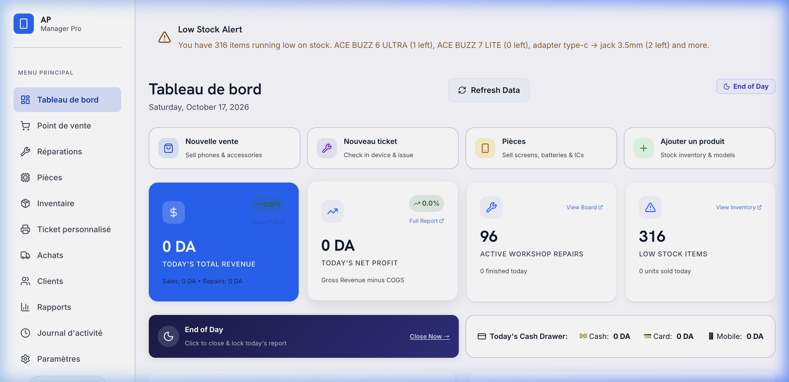
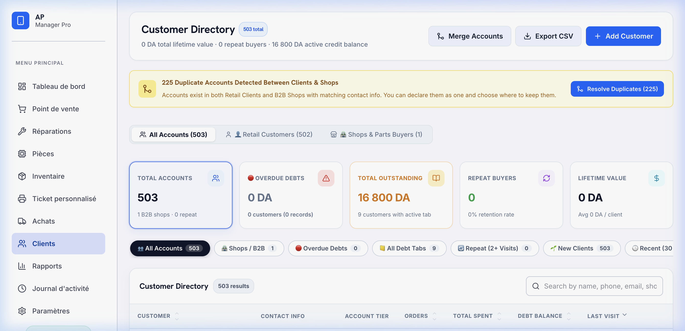
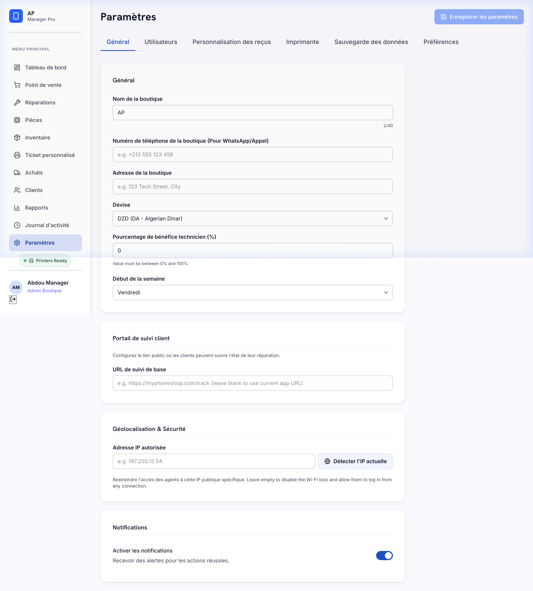
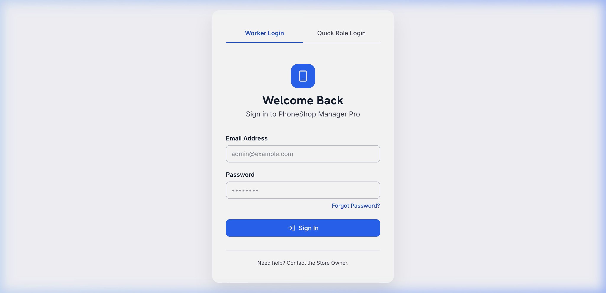

# 📱 PhoneShop Manager Pro — Complete Phone Repair Shop Management Suite

[](LICENSE)
[](https://react.dev/)
[](https://www.typescriptlang.org/)
[](https://vitejs.dev/)
[](https://firebase.google.com/)
[](https://expo.dev/)
[](https://nodejs.org/)
[](#️-thermal-printing--hardware-integration)

A powerful, all-in-one, production-grade management system designed specifically for **independent phone repair shops, smartphone retailers, and electronics service centers**. 

**PhoneShop Manager Pro** combines a high-speed Point of Sale (POS), a real-time Kanban repair management board, full inventory and spare parts tracking, supplier purchase orders, customer CRM with WhatsApp integration, financial analytics, multi-user role permissions, and direct silent thermal printing — accompanied by a dedicated **Android Management App** for shop owners, managers, cashiers, and workbench technicians.

---

## 📋 Table of Contents

- [🎯 Who Is This For?](#-who-is-this-for)
- [🧪 Live Demo](#-live-demo--quick-evaluation-account)
- [📦 Pre-Built App Releases & How to Install](#-pre-built-app-releases--how-to-install)
- [📸 Visual Tour](#-visual-tour--core-pages)
- [🌟 Feature Breakdown](#-comprehensive-feature-breakdown)
- [🖨️ Thermal Printing & Hardware](#️-thermal-printing--hardware-integration)
- [🏗️ Repository Architecture](#️-repository-architecture)
- [🚀 Installation & Setup](#-step-by-step-installation--setup)
  - [Step 1 — Clone](#step-1-clone-the-repository)
  - [Step 2 — Firebase Backend](#step-2-set-up-your-own-firebase-backend)
  - [Step 3 — Web Application](#step-3-configure-and-start-the-manager-web-application)
  - [Step 4 — First Login & Staff Roles](#step-4-first-login--managing-staff-roles-in-settings)
  - [Step 5 — Print Server](#step-5-start-the-hardware-print-server-optional)
  - [Step 6 — Desktop Builds](#step-6-standalone-desktop-applications-macos--windows)
  - [Step 7 — Android Management App](#step-7-android-management-app-technician-app)
- [🔒 Security Architecture](#-security--privacy-architecture)
- [🌍 Multi-Language & RTL](#-multi-language--localization)
- [💻 Tech Stack](#-tech-stack-summary)
- [🗺️ Roadmap](#️-roadmap)
- [🤝 Contributing](#-contributing)
- [📄 License](#-license)
- [💬 Community & Support](#-community--support)

---

## 🎯 Who Is This For?

- 🔧 **Independent repair shops** that need repairs + POS in one system — without paying \$100–200/month for SaaS alternatives
- 🏪 **Smartphone retailers** who want real inventory control with thermal printing and barcode scanning
- 👨‍💼 **Multi-role store teams** that need granular role access across desktop and mobile (Store Owners, Admins, Managers, Cashiers, Technicians)
- 🌍 **Arabic-speaking markets** requiring full RTL support across the POS, receipts, and financial reports

---

## 🧪 Live Demo & Quick Evaluation Account

Want to test drive the platform without configuring your own backend first? Use the pre-configured live evaluation environment:

| Field | Value |
|---|---|
| **🌐 Live Web Application** | **[https://ecomeweb-91a7e.web.app](https://ecomeweb-91a7e.web.app)** |
| **📱 Android Management APK** | **[Download Latest APK from Releases](https://github.com/abdouh071/phoneshop-manager/releases)** *(or [Direct Cloud Build](https://expo.dev/artifacts/eas/jZREECvoT6sghrPPJGYlPX3ruQHRKDgd_PCuIebENOk.apk))* |
| **Demo Login Email** | `Adou4849@gmail.com` |
| **Demo Password** | `Abdouh071` |
| **Assigned Role** | **Super Admin** *(Full master access to POS, Repairs, Inventory, Parts, Financials & Settings)* |

> [!CAUTION]
> **CRITICAL NOTICE FOR USERS CLONING THIS REPOSITORY:**
> The credentials and links above are provided strictly for sandbox preview and evaluation. **Anyone who clones or forks this project MUST set up their own dedicated Firebase database and create their own initial admin account** following [Step 2: Set Up Your Own Firebase Backend](#step-2-set-up-your-own-firebase-backend).
> - Never record real store inventory, customer IMEI numbers, cash transactions, or passwords in a shared demo database.
> - Always supply your own isolated project keys in `.env` and configure your own initial administrator account via the Firebase Console.

---

## 📦 Pre-Built App Releases & How to Install

> [!IMPORTANT]
> **PREVIEW & EVALUATION NOTICE:**
> The pre-built installers published under **[GitHub Releases](https://github.com/abdouh071/phoneshop-manager/releases)** (`.dmg`, `.exe`, `.apk`) are **compiled exclusively for demonstration and sandbox evaluation**. They are pre-connected to our shared evaluation database (`ecomeweb-91a7e`) to enable prospective shop owners and evaluators to test-drive native features immediately with zero setup.
> 
> **For Production Deployment in a Real Workshop or Store:**
> Because store data, customer IMEI records, financial ledgers, and cash balances must remain 100% confidential, **you must build your own custom standalone application packages** linked to your private Firebase database keys following:
> - **[Step 6: Standalone Desktop Applications (macOS & Windows)](#step-6-standalone-desktop-applications-macos--windows)**
> - **[Step 7: Android Management App](#step-7-android-management-app-technician-app)**
> 
> Compiling your own binaries takes just a single command (`npm run electron:build:...` or `eas build`) and ensures that your hardware and customer data remain strictly private and under your sole ownership.

Ready-to-use standalone desktop and mobile binaries are published under **[GitHub Releases](https://github.com/abdouh071/phoneshop-manager/releases)**:

| Package | Platform | Target Architecture | Description |
|---|---|---|---|
| **`PhoneShopPro-1.1.0-mac-arm64.dmg`** | macOS | Apple Silicon (M1, M2, M3, M4) | Standalone desktop application with integrated silent thermal print server |
| **`PhoneShopPro-1.1.0-mac-x64.dmg`** | macOS | Intel x86_64 Macs | Standalone desktop application with integrated silent thermal print server |
| **`PhoneShopPro-Setup-1.1.0-win-x64.exe`** | Windows | 64-bit (Windows 10 & 11) | Desktop installer with auto-spawning local thermal printing service |
| **`PhoneShopPro-Setup-1.1.0-win-ia32.exe`** | Windows | 32-bit (Windows 7, 8, 10 & 11) | Lightweight legacy Windows desktop installer |
| **`PhoneShop-Technician-1.1.0.apk`** | Android | Android 8.0+ Smartphones & Tablets | Standalone mobile management app with multi-role login & camera barcode scanner |

### 🛠️ Installation Instructions

#### 🍏 macOS (`.dmg`)
1. Download `PhoneShopPro-1.1.0-mac-arm64.dmg` (for M1–M4 Apple Silicon) or `PhoneShopPro-1.1.0-mac-x64.dmg` (for Intel).
2. Double-click the downloaded `.dmg` file and drag **PhoneShop Manager Pro** into your **Applications** folder.
3. Open the application.
   > **Note on macOS Gatekeeper:** Because the application is self-signed, macOS may show a prompt saying *"App cannot be opened because it is from an unidentified developer"*. To open:
   > - Right-click (or Control-click) `PhoneShop Manager Pro` in your Applications folder.
   > - Select **Open** from the menu, then click **Open** in the confirmation dialog. (You only need to do this once).

#### 🪟 Windows (`.exe`)
1. Download `PhoneShopPro-Setup-1.1.0-win-x64.exe` (or the 32-bit `ia32.exe` version for Windows 7 / 32-bit machines).
2. Double-click the installer and follow the setup wizard.
   > **Note on Windows SmartScreen:** If Windows Defender SmartScreen shows *"Windows protected your PC"*, click **More info** → **Run anyway**.
3. Launch **PhoneShop Manager Pro**. The hardware thermal print server will automatically start in the background on port `3355` — no manual setup or Node.js required!

#### 📱 Android Management App (`.apk`)
1. Download `PhoneShop-Technician-1.1.0.apk` directly to your Android device (or transfer it from your computer).
2. Tap the downloaded `.apk` file to install.
   *(If prompted by Android, tap **Settings** and enable **"Allow from this source"** / **"Install unknown apps"**).*
3. Open **PhoneShop Manager** directly from your phone's home screen.
4. Log in with any provisioned staff account — the app dynamically adjusts its features based on the assigned role:
   - 👑 **Super Admin / Store Owner**: Full shop overview, repair approvals, financial summaries, POS sales, and staff management.
   - 👔 **Manager**: Repair ticket updates, inventory tracking, POS checkout, and customer profiles.
   - 💰 **Cashier**: Fast POS sales counter (accessories & labor) and customer debt collection.
   - 🔧 **Technician**: Personal workbench repair queue, visual pattern lock viewer, and camera barcode scanner.

---

## 📸 Visual Tour & Core Pages

<table>
  <tr>
    <td align="center"><br/><b>📊 Executive Dashboard</b></td>
    <td align="center"><br/><b>🔧 Repair Kanban Board</b></td>
  </tr>
  <tr>
    <td align="center"><br/><b>🛒 Point of Sale (POS)</b></td>
    <td align="center"><br/><b>📦 Inventory Management</b></td>
  </tr>
  <tr>
    <td align="center"><br/><b>🔩 Spare Parts Catalog</b></td>
    <td align="center"><br/><b>📋 Purchasing & Suppliers</b></td>
  </tr>
  <tr>
    <td align="center"><br/><b>👥 Customer CRM</b></td>
    <td align="center"><br/><b>📈 Financial Analytics</b></td>
  </tr>
  <tr>
    <td align="center"><br/><b>📝 Audit & Activity Log</b></td>
    <td align="center"><br/><b>⚙️ Settings & Permissions</b></td>
  </tr>
  <tr>
    <td align="center" colspan="2"><br/><b>🔐 Secure Multi-User Login</b></td>
  </tr>
</table>

---

## 🌟 Comprehensive Feature Breakdown

### 1. 📊 Executive Dashboard & Real-Time Metrics
- **Key Metric KPI Cards**: Today's Gross Revenue, Active In-Shop Repairs, Low Stock Warning Count, Net Profit calculation.
- **Visual Performance Graphs**: Daily/weekly sales volume and revenue charts.
- **Repair Status Overview**: Live counts of devices currently in Diagnostic, Waiting for Parts, In Progress, and Ready for Pickup.
- **Quick Action Triggers**: Instant modal launches for *New Sale*, *New Repair Ticket*, *Add Inventory Item*, *Add Customer*, and *End of Day Closing*.
- **Live Activity Stream**: Real-time ticker showing recent sales, status transitions, and inventory updates.

### 2. 🔧 Repair Lifecycle & Kanban Operations
- **Interactive Kanban Pipeline**: Drag and drop cards smoothly through stages:
  - `New / Intake` → `In Diagnosis` → `Waiting for Parts` → `In Progress` → `Ready for Pickup` → `Completed` → `Cancelled / Unrepairable`.
- **Intake Diagnostics & Intake Form**:
  - Record device Brand, Model, Serial / IMEI number, and physical condition checklist (scratches, cracks, water damage).
  - Visual Pattern Lock Grid & PIN record for technician testing.
  - Problem description, accessories left behind (SIM card, case, charger).
  - Upfront deposit, estimated repair cost, and estimated completion date.
- **Technician Assignment**: Allocate specific repair tickets to designated technicians.
- **Spare Parts Allocation**: Deduct parts directly from parts inventory and link their cost to the ticket.
- **Public Customer Tracking Portal (`/tracking`)**: Generate unique tracking codes and QR codes printed on receipts so customers can check live repair progress online from any smartphone without logging in.
- **Printable Repair Stickers & Receipts**: Print 80mm intake claim checks for customers and 50x30mm adhesive barcode labels for the physical phone backplate.
- **Custom Ticket Builder**: Customize thermal intake tickets and customer claim receipts with your shop logo, warranty terms, and custom disclaimer notes.

### 3. 🛒 Point of Sale (POS) Counter
- **Barcode & Scanner Support**: Fast product lookup via handheld USB/Bluetooth barcode scanners or manual search.
- **Visual Product Grid**: Filter products by category (Smartphones, Cases, Chargers, Audio, Protection) with stock indicators.
- **Flexible Cart Management**:
  - Adjust quantities, apply item-level or total cart percentage/fixed discounts.
  - Customer selection with instant customer creation shortcut.
  - Custom line items for non-catalog services or labor.
- **Multi-Payment Processing**:
  - Cash (with automatic change due calculation).
  - Credit / Debit Card.
  - Bank Transfer / Mobile Money.
  - Split Payments across multiple tender types.
- **1-Click Silent Thermal Printing**: Immediate 80mm receipt generation with store logo, tax breakdown, footer notes, and barcode.

### 4. 📦 Inventory & Stock Control
- **Product Cataloging**: SKU, Barcode, Brand, Model compatibility, Category, and item description.
- **Price Architecture**: Track Unit Cost vs. Retail Selling Price with automatic margin percentage calculation.
- **Stock Level Management**: Current stock on hand, min stock threshold, and reorder warning badges.
- **Stock Adjustments**: Log manual inventory adjustments (Damage, Theft, Loss, Stock Count reconciliation) with required reason notes.
- **Filter & Search**: Instant real-time filtering across thousands of inventory items.

### 5. 🔩 Phone Spare Parts Management
- **Specialized Component Catalog**: Screens (OLED, LCD, Original, Aftermarket), Batteries, Charging Ports, Cameras, Back Glass, Speakers, Motherboard flex cables.
- **Model Compatibility Mapping**: Tag parts with supported device models (e.g., iPhone 13 / 13 Pro, Samsung S23).
- **Cost & Stock Tracking**: Separate parts stock from retail items to ensure clean financial reporting.
- **Direct Repair Integration**: Easily attach parts to repair tickets during repair workflows.

### 6. 📋 Purchasing & Supplier Orders
- **Supplier Directory**: Maintain records of parts vendors, phone distributors, contact persons, phone numbers, and addresses.
- **Purchase Order Tracking**: Record incoming stock shipments, ordered quantities, unit costs, and arrival dates.
- **Financial Balance Tracking**: Manage payment status per PO (Fully Paid, Partially Paid, Unpaid balance).
- **Automated Stock Ingestion**: Receive shipments with one click to automatically increment retail and parts stock counts.

### 7. 👥 Customer Relationship Management (CRM)
- **Comprehensive Profiles**: Customer name, primary phone number, secondary phone, email, physical address, and internal notes.
- **Interaction History**: Complete log of all past repair orders and retail purchases made by the customer.
- **Customer Account Statement (Relevé de Compte)**: Generate comprehensive, printable statements showing total purchases, debts, payments, remaining balance, and itemized transaction timeline with instant PDF export.
- **Smart Customer Deduplication & Merge**: Detect duplicate customer profiles by phone number or name, and merge them with 1 click while safely consolidating all tickets, sales history, and debt ledgers.
- **Credit & Debt Ledger**: Per-customer debt tracking with status badges (`Pending`, `Partial`, `Settled`), installment payment logging, and balance limits.
- **1-Click WhatsApp Communication**: Open pre-formatted WhatsApp chat messages to notify customers when their device is ready for pickup or needs estimate approval.

### 8. 🌅 End of Day (Z-Report) Cash Reconciliation
- **Register Closing Wizard**: Structured closing workflow at the end of each shift or business day.
- **Cash Drawer Count**: Enter actual physical cash counted in drawer against expected system cash.
- **Discrepancy Reporting**: Automatic calculation of cash overage or shortage with mandatory explanation notes.
- **Summary Breakdown**: Total sales, cash sales, card sales, repair deposits collected, payouts, and net totals.
- **Thermal Daily Summary Print**: Direct printing of the daily financial summary for management archiving.

### 9. 📈 Advanced Reports & Business Analytics
- **Sales Analytics**: Revenue, profit margins, and sales volume segmented by day, week, month, or custom date range.
- **Repair Turnaround Metrics**: Average time from device intake to completion; analysis of top device failure causes.
- **Product & Category Performance**: Identify best-selling accessories and highest-margin repair services.
- **Technician Productivity**: Repairs completed per technician, revenue generated, and active workload balance.
- **Data Export**: Export tables and reports to CSV for external accounting or tax preparation.

### 10. 📝 Comprehensive Audit Trail (Activity Log)
- **Granular Activity Tracking**: Automatic logging of all critical actions:
  - User logins and session starts.
  - New repairs created, status transitions, technician reassignments.
  - POS sales completed, refunds, and voided tickets.
  - Inventory quantity changes and cost adjustments.
  - System configuration and user permission updates.
- **Searchable & Filterable**: Filter activity logs by user, date range, or action category.

### 11. ⚙️ Settings, Customization & Multi-User Access
- **Store Identity**: Customize shop name, legal registration number, phone numbers, address, tax rate, and receipt header/footer messages.
- **Multi-Currency & Tax Engine**: Set default currency symbol, position (prefix/suffix), and inclusive/exclusive tax rates.
- **In-App Role Assignment & Team Management (`Settings ⚙️ → Users & Staff`)**:
  - The shop administrator assigns and updates roles directly from the user management interface in Settings with instant real-time synchronization across both desktop terminals and mobile devices.
  - **Super Admin**: Unrestricted master control, database bootstrap ownership, global configuration, user provisioning, and role assignment.
  - **Store Owner**: Complete financial reporting (profit & loss, margins, expenses), inventory pricing rules, supplier orders, and staff performance oversight.
  - **Manager**: Day-to-day operations, repair approvals, ticket intake modifications, inventory stock counts, and POS override privileges.
  - **Cashier / Sales Staff**: High-speed POS counter sales, walk-in customer creation, payment processing, intake receipt issuance, and cash drawer management.
  - **Technician**: Workbench repair pipeline queue, diagnostics entry, parts allocation to tickets, visual pattern unlock tester, and camera barcode scanner.
- **Multi-Language & RTL Layout**: Seamless toggle between English, French, and full Right-to-Left (RTL) Arabic.

### 12. 📲 Android Management App (`technician-app`)
- **Full Multi-Role Support (Admins, Managers, Cashiers & Technicians)**: Unlike basic technician-only utilities, the Android Management App dynamically customizes its interface and permissions based on the logged-in staff role:
  - 👑 **Super Admin & Store Owner**: High-level store health, today's revenue KPIs, active repair pipeline counts, and master access on the go.
  - 👔 **Store Manager**: Oversee workbench progress, approve repair estimates, update ticket statuses, and access customer history.
  - 💰 **Cashier / Sales Staff**: Fast mobile counter POS with barcode scanning for walk-in accessories and quick service sales.
  - 🔧 **Repair Technician**: Personal workbench queue, visual pattern unlock tester, parts usage allocation, and commission tracking.
- **Biometric Authentication (Face ID & Fingerprint Lock)**: Quick biometric unlock so staff can access the app securely at the bench or on the counter without repeatedly typing passwords.
- **Assigned Workbench Pipeline**: Filter active repairs by status (`In Diagnosis`, `Waiting for Parts`, `In Progress`, `Ready for Pickup`).
- **Direct Ticket Assignment & Reassignment**: Reassign tickets between staff and technicians directly from mobile.
- **Mobile Counter POS (Dual Mode: Products & Services)**: Fast POS counter on mobile with dedicated tabs for retail accessories and technician repair labor/services.
- **Interactive 3x3 Pattern Lock Canvas & PIN**: View the client's screen unlock pattern visually on the mobile screen to easily test device touch, cameras, and components.
- **Hardware Camera Barcode Scanner**: Scan the adhesive repair sticker on the phone's backplate to open the exact ticket in under a second without typing.
- **New Ticket Intake on the Go**: Rapid intake form allowing floor staff to register new repair orders directly from their smartphone.
- **Personal Earnings & Productivity Reports**: Track daily/weekly completed repairs, turnaround speed, and calculated repair commissions.
- **Instant Cloud Sync**: Any status transition or note added on mobile immediately updates the manager's desktop Kanban board and the customer's live tracking link.
- **Multi-Language & Dark Mode**: Full support for English, French, and Arabic RTL layout with an eye-friendly dark theme.
- **Cross-Platform**: Built with **React Native & Expo SDK 57** for standalone native deployment on Android smartphones and tablets.

---

## 🖨️ Thermal Printing & Hardware Integration

PhoneShop Manager Pro features a dedicated, local printing microservice located in `phone-shop-manager/print-server/`. Built with **Node.js & Express.js**, it operates locally on port `3355` and bridges the web dashboard directly to hardware thermal printers for **silent, 1-click instantaneous printing** without browser print popups.

```
┌────────────────────────┐         HTTP POST (JSON)         ┌────────────────────────┐
│  React Web Application │ ────────────────────────────────> │ Local Node.js Server   │
│  (localhost:5173)      │ <──────────────────────────────── │ (localhost:3355)       │
└────────────────────────┘          Print Job Status         └───────────┬────────────┘
                                                                         │ ESC/POS / TSPL
                                                                         ▼
                                                             ┌────────────────────────┐
                                                             │ Hardware Thermal       │
                                                             │ Receipt & Label Printer│
                                                             └────────────────────────┘
```

### 🏷️ Hardware Compatibility & Tested Devices
The printing engine has been **thoroughly field-tested and optimized for Xprinter hardware**:
- **Xprinter XP-T80Q / POS-80**: 80mm High-Speed Thermal Receipt Printer (ESC/POS protocol, auto-cutter support, bold headers, formatted tabular receipt columns).
- **Xprinter XP-420B**: High-resolution Thermal Barcode & Label Printer (TSPL protocol, perfect for 50x30mm or 40x30mm adhesive repair stickers and barcode tags).
- **Generic ESC/POS Printers**: Compatible with standard USB, Ethernet, or serial ESC/POS thermal printers connected to macOS, Linux, or Windows spoolers.

### 📋 Print Server Environment Configuration (`print-server/.env`)

| Variable | Description | Default |
|---|---|---|
| `PRINTER_NAME` | System printer name for 80mm cash receipts (`lpstat -p -d`) | `XP_T80Q` |
| `LABEL_PRINTER_NAME` | System printer name for sticky repair labels | `XP_420B` |
| `PORT` | Local service port for print API | `3355` |
| `HAS_CUTTER` | Automatically triggers paper cutter after receipt | `true` |
| `LABEL_OFFSET_X` | Horizontal label margin calibration in printer dots | `12` |

---

## 🏗️ Repository Architecture

```
phoneshop-manager/
├── docs/
│   └── screenshots/           # Application screenshots for documentation
│       ├── login.png
│       ├── dashboard.png
│       ├── repairs.png
│       ├── pos.png
│       ├── inventory.png
│       ├── parts.png
│       ├── purchasing.png
│       ├── customers.png
│       ├── reports.png
│       ├── activity.png
│       └── settings.png
│
├── phone-shop-manager/        # Main Desktop Web Application
│   ├── src/
│   │   ├── features/          # Feature domains (pos, repairs, inventory, etc.)
│   │   ├── components/        # Reusable UI component library
│   │   ├── store/             # Zustand state stores
│   │   ├── services/          # Firebase Firestore & Auth integration
│   │   ├── locales/           # i18n translation catalogs (en, fr, ar)
│   │   ├── hooks/             # Custom React lifecycle hooks
│   │   ├── lib/               # Firebase initialization and constants
│   │   ├── types/             # TypeScript interfaces and permission types
│   │   └── utils/             # Formatters, calculations, barcode helpers
│   ├── print-server/          # Dedicated Node.js ESC/POS & TSPL print server
│   │   ├── server.js          # Express endpoints for receipt & label dispatch
│   │   ├── package.json
│   │   └── .env.example
│   ├── electron/              # Optional desktop wrapper configuration
│   ├── index.html
│   ├── package.json
│   ├── vite.config.ts
│   └── .env.example
│
├── technician-app/            # Android Management App (Multi-Role Mobile App)
│   ├── src/
│   │   ├── screens/           # Mobile screens (repairs, details, profile)
│   │   ├── components/        # Mobile UI elements
│   │   ├── store/             # Mobile state management
│   │   └── lib/               # Firebase client for React Native
│   ├── app.json               # Expo configuration
│   ├── package.json
│   └── .env.example
│
├── firestore.rules            # Production-grade Firestore security rules
├── LICENSE                    # Open source MIT license
└── README.md                  # System manual and documentation
```

---

## 🚀 Step-by-Step Installation & Setup

### Prerequisites
- **Node.js** (v18.x or v20.x recommended) and **npm**
- A free **Google Firebase** account ([console.firebase.google.com](https://console.firebase.google.com))
- Modern Web Browser (Chrome, Edge, Brave, or Safari)
- *(Optional)* Thermal receipt or label printer for hardware printing

---

### Step 1: Clone the Repository

```bash
git clone https://github.com/abdouh071/phoneshop-manager.git
cd phoneshop-manager
```

---

### Step 2: Set Up Your Own Firebase Backend

> [!CAUTION]
> **MANDATORY FOR WORKSHOP PRODUCTION DEPLOYMENTS:**
> If you are setting up this system for your own shop, **do not rely on the demo project**. You must create your own isolated Firebase project, configure your own credentials in `.env`, and create your own initial administrator account as described below.

1. Navigate to the [Firebase Console](https://console.firebase.google.com/) and click **Add project**.
2. Give your project a name (e.g., `my-phone-shop`).
3. Enable **Authentication**:
   - Go to **Build → Authentication → Get Started**.
   - Under the **Sign-in method** tab, enable **Email/Password**.
4. Enable **Cloud Firestore Database**:
   - Go to **Build → Firestore Database → Create Database**.
   - Choose your preferred server region and start in **Test mode** (or deploy the included rules in step 2.3).
5. Register a Web App:
   - Click the Gear icon ⚙️ next to **Project Overview** → **Project settings**.
   - Under **Your apps**, click the Web icon `</>` to register your web application.
   - Note down the `firebaseConfig` keys provided.

#### 👤 Creating the First Account via Firebase (Initial Super Admin)
Because this is a private enterprise application with sensitive store and customer data, **there is intentionally no public "Sign Up" button** on the login screen (preventing unauthorized public registrations).

> [!IMPORTANT]
> **The very first user MUST be added directly in Firebase (Console / Database):**
> 1. In the [Firebase Console](https://console.firebase.google.com/), open your project and go to **Authentication → Users**.
> 2. Click **Add User**.
> 3. Enter your email (e.g. `admin@example.com` or your personal email) and set a secure password.
> 4. Click **Add User** to save.

#### 🛡️ Auto-Bootstrapping to Super Admin
The system features an **automated initial bootstrap mechanism**:
- When the first user ever created in the database logs in, the system automatically detects that no profiles exist yet (or matches `VITE_SUPER_ADMIN_EMAIL`) and **automatically crowns that first account as the Super Admin** with full master permissions in Firestore.
- You do **not** need to manually construct Firestore documents or set roles in JSON.

1. Deploy the security rules to your Firebase project:
   ```bash
   npx firebase-tools login
   npx firebase-tools use --add
   npx firebase-tools deploy --only firestore:rules
   ```
   *(The included `firestore.rules` already supports initial auto-bootstrap and grants administrative ownership)*.

---

### Step 3: Configure and Start the Manager Web Application

1. Navigate to the web application directory and install dependencies:
   ```bash
   cd phone-shop-manager
   npm install
   ```

2. Create your environment configuration file:
   ```bash
   cp .env.example .env
   ```

3. Open `.env` and fill in your Firebase project parameters:
   ```env
   VITE_FIREBASE_API_KEY=AIzaSyA1234567890abcdef
   VITE_FIREBASE_AUTH_DOMAIN=my-phone-shop.firebaseapp.com
   VITE_FIREBASE_PROJECT_ID=my-phone-shop
   VITE_FIREBASE_STORAGE_BUCKET=my-phone-shop.firebasestorage.app
   VITE_FIREBASE_MESSAGING_SENDER_ID=123456789012
   VITE_FIREBASE_APP_ID=1:123456789012:web:abcdef123456
   VITE_SUPER_ADMIN_EMAIL=admin@example.com
   ```
   *(Ensure `VITE_SUPER_ADMIN_EMAIL` matches the admin email you created in Firebase Auth)*.

4. Start the development server:
   ```bash
   npm run dev
   ```
   The application will be live at **http://localhost:5173**.

---

### Step 4: First Login & Managing Staff Roles in Settings

1. Open your browser and navigate to **http://localhost:5173** (or your hosted URL).
2. Log in using the initial administrator credentials you created in Firebase.
3. **Automatic Super Admin Activation**: Upon successful sign-in, the system automatically creates your master administrator profile in Firestore, granting complete access to financial reports, inventory, system settings, and user management.
4. **Assigning & Managing Roles in Settings (`Settings ⚙️ → Users & Staff`)**:
   > [!TIP]
   > **All team member creation, role assignments, and permission updates are managed 100% in-app!**
   > You never need to touch the Firebase Console or write JSON database records:
   - Navigate to **Settings ⚙️ → Users & Staff**.
   - **To Add a New Staff Member**:
     - Click **Add User** (or "+ New Staff Member").
     - Enter their Name, Email, and temporary Password.
     - Select their Role from the dropdown:
       - **Admin / Store Owner**: Full operational, financial, and management privileges.
       - **Manager**: Day-to-day oversight, inventory control, repair approvals, and POS.
       - **Cashier / Sales Agent**: POS sales counter, customer debt ledger, and basic repair intake.
       - **Repair Technician**: Assigned workbench queue, visual pattern lock canvas, parts allocation, and mobile app access.
     - Click **Save**. The system instantly provisions both their Firebase Authentication identity and their role-guarded Firestore profile with the appropriate permission matrix.
   - **To Change or Reassign an Existing Member's Role**:
     - In the staff list under **Users & Staff**, click **Edit** next to any employee.
     - Change their role in the dropdown and click **Save**.
     - Permissions update immediately across both desktop sessions and the Android Management App in real time without requiring account recreation.

---

### Step 5: Start the Hardware Print Server (Optional)
If you have an 80mm thermal receipt printer or adhesive label printer connected to your computer:

1. Open a new terminal window:
   ```bash
   cd phone-shop-manager/print-server
   npm install
   ```

2. Create your print server configuration:
   ```bash
   cp .env.example .env
   ```

3. Identify your system printer names:
   - On macOS/Linux: Run `lpstat -p -d`
   - On Windows: Check printer names in *Control Panel → Devices and Printers*

4. Edit `print-server/.env`:
   ```env
   PRINTER_NAME=XP_T80Q
   LABEL_PRINTER_NAME=XP_420B
   PORT=3355
   HAS_CUTTER=true
   LABEL_OFFSET_X=12
   ```

5. Launch the print server:
   ```bash
   node server.js
   ```
   The print server will listen on port `3355`. When you click "Print Receipt" or "Print Label" anywhere in the web app, print jobs will dispatch instantly to your thermal printer.

---

### Step 6: Standalone Desktop Applications (macOS & Windows)

For counter cashiers and shop managers, **PhoneShop Manager Pro** can be packaged into standalone native desktop applications with an **integrated auto-starting thermal print server**.

> [!TIP]
> **Zero hardware configuration required on counter machines!** When you launch any packaged desktop application, the hardware thermal print server automatically boots in the background on port `3355`, ready to dispatch receipts and sticky repair labels to USB, Network, and Windows shared printers without requiring Node.js to be installed on the machine.

#### 🛠️ How to Build Desktop Installers with Your Own API Keys

In Electron desktop applications, Firebase credentials and configurations are **compiled directly into the local application bundle**. Follow these steps to build your own installers:

1. **Populate Your Firebase Credentials**:
   Open `phone-shop-manager/.env` (create it from `.env.example`) and fill in your Firebase project parameters:
   ```env
   VITE_FIREBASE_API_KEY=AIzaSyA1234567890abcdef
   VITE_FIREBASE_AUTH_DOMAIN=my-phone-shop.firebaseapp.com
   VITE_FIREBASE_PROJECT_ID=my-phone-shop
   VITE_FIREBASE_STORAGE_BUCKET=my-phone-shop.firebasestorage.app
   VITE_FIREBASE_MESSAGING_SENDER_ID=123456789012
   VITE_FIREBASE_APP_ID=1:123456789012:web:abcdef123456
   VITE_SUPER_ADMIN_EMAIL=admin@example.com
   ```

2. **Compile the Production Web Bundle**:
   ```bash
   cd phone-shop-manager
   npm install
   npm run build
   ```
   *(This validates TypeScript and builds the optimized frontend bundle in `dist/` with your credentials inlined).*

3. **Package the Desktop Installer for Your Operating System**:
   Run the build script corresponding to your target platform:

   | Platform | Build Command | Output File | Architecture | Compatibility Notes |
   |---|---|---|---|---|
   | 🍏 **macOS (Apple Silicon)** | `npm run electron:build:mac:arm64` | `../releases/PhoneShopPro-1.1.0-mac-arm64.dmg` | `arm64` | Apple M1, M2, M3, M4 Macs |
   | 🍏 **macOS (Intel)** | `npm run electron:build:mac:intel` | `../releases/PhoneShopPro-1.1.0-mac-x64.dmg` | `x86_64` | Intel-based Macs |
   | 🪟 **Windows 64-bit** | `npm run electron:build:win` | `../releases/PhoneShopPro-Setup-1.1.0-win-x64.exe` | `x64` | Windows 10 & Windows 11 |
   | 🪟 **Windows Legacy / 32-bit** | `npm run electron:build:win7` | `../releases/win7-ia32/PhoneShopPro-Setup-1.1.0-win-ia32.exe` | `ia32` | Windows 7, 8, 8.1, 10 & 11 (32-bit & 64-bit) |

   All generated installers will be saved in the [`releases/`](releases/) folder. Every installer automatically carries the embedded thermal print server inside its resource bundle.

---

### Step 7: Android Management App (`technician-app`)

The **Android Management App** is a purpose-built React Native & Expo mobile application for Android smartphones and tablets. **It now features full multi-role RBAC support**, empowering Store Owners, Managers, Cashiers, and Workshop Technicians to manage the business directly from their mobile devices:
- 👑 **Store Owners & Admins**: View overall revenue, profit margins, repair volume, and staff activities on the go.
- 👔 **Managers**: Oversee live repairs, approve estimates, update repair stages, and access client ledgers.
- 💰 **Cashiers**: Process walk-in accessory sales and diagnostic intake fees via the mobile POS counter.
- 🔧 **Technicians**: Bench workbench queue, visual pattern lock viewer, and camera barcode scanner.

#### 👤 How to Create Accounts to Log Into the Mobile App
For security, the mobile app connects directly to your Firestore database and strictly enforces role permissions. **Users cannot register themselves publicly**; accounts are created by the shop administrator:

1. Open the main **PhoneShop Manager Pro** desktop web dashboard (`http://localhost:5173`).
2. Log in with your **Admin / Super Admin** account.
3. Navigate to **Settings → Users** tab.
4. Click **Add User** (or "New Staff Member"):
   - Enter Full Name (e.g., `Samir Manager` or `Karim Technician`).
   - Enter Staff Email (e.g., `staff@myshop.com`).
   - Enter a Secure Password.
   - Select the desired Role:
     - **Admin / Store Owner**: Master mobile permissions and analytics.
     - **Manager**: Repair oversight, approvals, and inventory.
     - **Cashier / Sales**: Mobile POS sales and basic repair intake.
     - **Technician**: Workbench repair queue, pattern lock viewer, and barcode scanner.
5. Click **Save**.
6. The account is instantly authorized. Staff can now open the Android app and log in with their assigned credentials.

---

#### 📱 How to Build the Standalone Android App (`.apk`) with Your Own Keys

The mobile app is engineered to run as a **100% standalone native Android app**. Staff install the `.apk` directly on their Android devices and launch it from their home screen — **no Expo Go app or computer connection required**.

##### 1. Prerequisites & Free Expo Account Setup:
EAS Cloud Build compiles Android `.apk` files directly on Expo's cloud servers for free.

1. **Create a Free Expo Account**:
   - Go to [https://expo.dev/signup](https://expo.dev/signup) and create a free account (no credit card required; the free tier includes free cloud builds).
2. **Install the EAS CLI Globally**:
   ```bash
   npm install -g eas-cli
   ```
3. **Log In to Expo via Terminal**:
   ```bash
   eas login
   ```
   *(Enter your Expo username / email and password when prompted).*
4. **Verify Your Terminal Session**:
   ```bash
   eas whoami
   ```
   *(Confirms you are authenticated as your Expo account).*
5. **Link the Mobile App to Your Own Expo Account**:
   ```bash
   cd technician-app
   eas init
   ```
   *(When asked to configure or create a project, select **Yes / Create new project** to link `app.json` directly to your own personal Expo account).*

##### 2. Configure Your Firebase Keys in the App:
In React Native, environment variables starting with `EXPO_PUBLIC_` are baked into the compiled APK at build time.

1. Create `technician-app/.env` (copy from `.env.example`) and fill in your Firebase project parameters:
   ```env
   EXPO_PUBLIC_FIREBASE_API_KEY=AIzaSyA1234567890abcdef
   EXPO_PUBLIC_FIREBASE_AUTH_DOMAIN=my-phone-shop.firebaseapp.com
   EXPO_PUBLIC_FIREBASE_PROJECT_ID=my-phone-shop
   EXPO_PUBLIC_FIREBASE_STORAGE_BUCKET=my-phone-shop.firebasestorage.app
   EXPO_PUBLIC_FIREBASE_MESSAGING_SENDER_ID=123456789012
   EXPO_PUBLIC_FIREBASE_APP_ID=1:123456789012:web:abcdef123456
   ```

2. Open `technician-app/eas.json` and set your credentials inside the `preview` profile `env` block so EAS Cloud injects them during packaging:
   ```json
   "preview": {
     "distribution": "internal",
     "channel": "preview",
     "android": {
       "buildType": "apk"
     },
     "env": {
       "EXPO_PUBLIC_FIREBASE_API_KEY": "AIzaSyA1234567890abcdef",
       "EXPO_PUBLIC_FIREBASE_AUTH_DOMAIN": "my-phone-shop.firebaseapp.com",
       "EXPO_PUBLIC_FIREBASE_PROJECT_ID": "my-phone-shop",
       "EXPO_PUBLIC_FIREBASE_STORAGE_BUCKET": "my-phone-shop.firebasestorage.app",
       "EXPO_PUBLIC_FIREBASE_MESSAGING_SENDER_ID": "123456789012",
       "EXPO_PUBLIC_FIREBASE_APP_ID": "1:123456789012:web:abcdef123456"
     }
   }
   ```

3. *(Optional)*: Download `google-services.json` from the [Firebase Console](https://console.firebase.google.com/) (**Project Settings ⚙️ → General → Your apps → Add Android App** with package name `com.phoneshop.technicianapp`) and place the downloaded file into `technician-app/google-services.json`.

##### 3. Build the Standalone Android APK:
In your terminal, navigate to the `technician-app/` folder and launch the EAS build:

```bash
cd technician-app
npm install
eas build --platform android --profile preview
```

> [!TIP]
> **Automatic Keystore Generation:** When running this for the first time, EAS will ask:
> *"Would you like to generate a new Android Keystore?"*
> Simply press **Enter (Yes)**. Expo will automatically generate the Android signing credentials and store them securely on their cloud server with zero manual configuration.

EAS Build will compile the native Android package in the cloud. When the build completes (typically 4–6 minutes), the terminal will display:
- A **direct download link** to the `.apk` file.
- A **terminal QR code** for instant mobile scanning.

##### 4. Install Directly on Android Devices:
1. Open the download link on any Android smartphone or tablet (or scan the QR code).
2. Download the `technician-app-preview.apk` file.
3. Tap the file in your notifications or downloads folder to install.
   *(If prompted by Android, tap "Settings" and enable "Allow from this source" / "Install unknown apps").*
4. **Done!** The app icon (`Auto-Manager`) appears directly on your Android device's home screen, completely independent and ready for daily workshop usage.

---

#### 🛠️ Daily Technician Workflow

1. **Fast Biometric / Password Sign In**: Technicians log in using their assigned staff credentials or unlock with **Fingerprint / Face ID** for quick access at the bench.
2. **Assigned Workbench Queue**: View active repairs in a structured queue, filterable by tabs (`All`, `In Diagnosis`, `Waiting for Parts`, `In Progress`, `Ready for Pickup`).
3. **Hardware Camera Barcode Scanner**: Tap the scanner icon on the top right. Point the camera at the adhesive barcode label on the device backplate to open the ticket in under a second.
4. **Visual Pattern Lock & PIN Testing**: Inspect the customer's visual 3x3 pattern lock grid or numerical PIN to test touchscreen, cameras, speakers, and charging.
5. **Direct Status & Technician Reassignment**: Update repair stages (`Start Repair`, `Waiting for Parts`, `Mark Ready for Pickup`) or reassign tickets between bench technicians with instant real-time sync to the desktop dashboard.
6. **Mobile Counter POS (Dual Mode)**: Switch between *Products* and *Services* tabs to process quick walk-in accessory sales or labor fees directly from the smartphone.
7. **New Walk-in Ticket Intake**: Register new repairs on the spot from the phone using the `+ New Ticket` button.

---

## 🔒 Security & Privacy Architecture

- **100% Data Sovereignty**: All your data lives in **your own Firebase project**. No third-party servers, telemetry, or external analytics have access to your client records, financial metrics, or sales figures.
- **Strict Role-Based Firestore Rules**: Read, write, and delete permissions are enforced directly at the database layer via [`firestore.rules`](firestore.rules).
- **Environment Isolation**: API keys and master emails are stored in `.env` files that are strictly excluded by `.gitignore`.
- **Zero Risk to Other Users**: When anyone deploys this repository, they link it to their own separate Firebase credentials; no data is ever shared across installations.

---

## 🌍 Multi-Language & Localization

PhoneShop Manager Pro features built-in internationalization across the entire user interface:

| Language | Code | Layout Direction | Supported Features |
|---|---|---|---|
| **English** | `en` | Left-to-Right (LTR) | Complete UI, receipts, notifications, charts |
| **French** | `fr` | Left-to-Right (LTR) | Complete UI, receipts, notifications, charts |
| **Arabic** | `ar` | **Right-to-Left (RTL)** | Complete UI with mirrored RTL navigation, Arabic receipts & currencies |

Language can be switched instantly from the top navigation bar or under **Settings**.

---

## 💻 Tech Stack Summary

| Layer | Technologies |
|---|---|
| **Web Frontend** | React 19, TypeScript 5, Vite 6, TailwindCSS / CSS Modules, Lucide Icons |
| **State Management** | Zustand |
| **Backend & Database** | Google Cloud Firestore, Firebase Authentication |
| **Print Server** | Node.js, Express.js, `node-thermal-printer` |
| **Android Management App** | React Native, Expo SDK 57, Expo Router (Multi-Role RBAC: Owner, Manager, Cashier, Tech) |
| **Desktop Wrapper** | Electron — packaged as macOS `.dmg` and Windows `.exe` installers |
| **i18n & RTL** | i18next, react-i18next |

---

## 🗺️ Roadmap

Planned improvements and upcoming features:

- [ ] WhatsApp Business API integration (auto-send repair status updates to customers)
- [ ] Multi-branch / multi-location support with per-branch dashboards
- [ ] Customer-facing repair tracking PWA (no login required)
- [ ] Offline-first mode with local PouchDB sync for unstable internet environments
- [ ] Advanced expense tracking module (rent, utilities, salaries)
- [ ] Scheduled SMS notifications via Twilio / local SMS gateway

---

## 🤝 Contributing

We welcome contributions from the community! Whether you want to add support for new thermal printers, improve translations, or introduce new features:

1. Fork the repository
2. Create your feature branch (`git checkout -b feature/awesome-feature`)
3. Commit your changes (`git commit -m 'Add awesome feature'`)
4. Push to your branch (`git push origin feature/awesome-feature`)
5. Open a Pull Request

**Before submitting a PR, please:**
- Run `npm run build` and confirm there are no TypeScript errors
- If touching translations, update all 3 locale files (`en`, `fr`, `ar`) in `phone-shop-manager/src/locales/`
- If adding a UI feature, add or update a screenshot in `docs/screenshots/`
- Keep pull requests focused — one feature or fix per PR

---

## 📄 License

This project is licensed under the **MIT License** — see the [LICENSE](LICENSE) file for complete details. You are free to use, modify, distribute, and deploy this software for commercial or personal use.

---

## 💬 Community & Support

- 🐛 **Bug reports & feature requests**: [Open an Issue](https://github.com/abdouh071/phoneshop-manager/issues)
- 💬 **Questions & setup help**: [GitHub Discussions](https://github.com/abdouh071/phoneshop-manager/discussions)
- ⭐ **If this saved you time or money**, please give it a star on GitHub — it helps the project grow!

Built with ❤️ for phone repair shop owners, independent technicians, and small electronics retail businesses worldwide.
