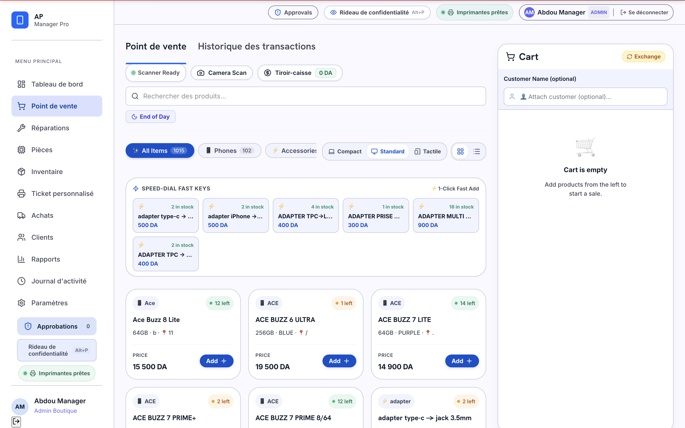
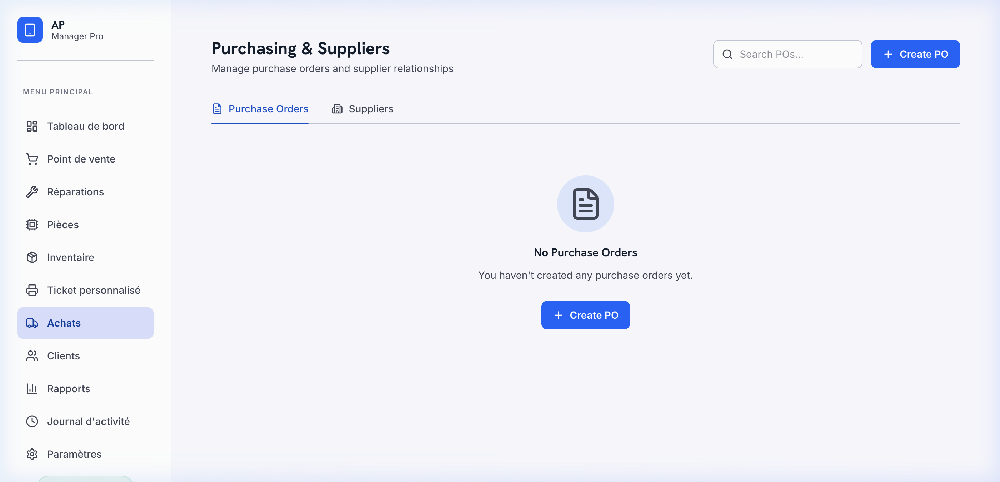

⭐ **If this project saves you time or money, please give it a star — it helps the project grow!**

# 📱 PhoneShop Manager Pro — Complete Phone Repair Shop Management Suite

[](LICENSE)
[](https://react.dev/)
[](https://www.typescriptlang.org/)
[](https://vitejs.dev/)
[](https://firebase.google.com/)
[](https://expo.dev/)
[](https://nodejs.org/)
[](#️-thermal-printing--hardware-integration)

A powerful, all-in-one, production-grade management suite built specifically for **independent phone repair shops, smartphone retailers, and electronics service centers**.

**PhoneShop Manager Pro** combines a high-speed Point of Sale (POS), a real-time Kanban repair management board, full spare parts inventory tracking, supplier purchase orders, customer CRM with WhatsApp integration, end-of-day financial reconciliation, granular role permissions, and direct silent thermal printing — accompanied by a dedicated **Android Management App** for shop owners, managers, cashiers, and workbench technicians.

---

## 📋 Table of Contents

- [🎯 Key Highlights](#-key-highlights)
- [🧪 Live Evaluation Demo](#-live-evaluation-demo)
- [📦 Pre-Built App Downloads](#-pre-built-app-downloads)
- [📸 Visual Tour](#-visual-tour)
- [🌟 Feature Breakdown](#-comprehensive-feature-breakdown)
  - [1. Executive Dashboard](#1--executive-dashboard--kpis)
  - [2. Repair Lifecycle & Kanban](#2--repair-lifecycle--kanban-operations)
  - [3. Point of Sale (POS)](#3--point-of-sale-pos-counter)
  - [4. Inventory & Stock Control](#4--inventory--stock-control)
  - [5. Spare Parts Catalog](#5--phone-spare-parts-catalog)
  - [6. Purchasing & Suppliers](#6--purchasing--supplier-orders)
  - [7. Customer CRM & WhatsApp](#7--customer-relationship-management-crm)
  - [8. End of Day Cash Closing](#8--end-of-day-z-report-cash-closing)
  - [9. Financial Reports & Analytics](#9--financial-reports--analytics)
  - [10. Audit & Activity Trail](#10--audit-trail--activity-log)
  - [11. Roles & Permissions (RBAC Matrix)](#11--granular-role-based-access-control-rbac)
  - [12. Android Management App](#12--android-management-app-technician-app)
- [🖨️ Thermal Printing & Hardware Integration](#-thermal-printing--hardware-integration)
- [🏗️ Repository Architecture](#-repository-architecture)
- [🚀 Quick Start & Installation](#-quick-start--installation)
  - [Prerequisites](#prerequisites)
  - [Step 1 — Clone Repository](#step-1-clone-the-repository)
  - [Step 2 — Firebase Backend Setup](#step-2-set-up-your-own-firebase-backend)
  - [Step 3 — Launch Web Dashboard](#step-3-configure-and-start-the-manager-web-application)
  - [Step 4 — Start Print Server (Optional)](#step-4-start-the-hardware-print-server-optional)
  - [Step 5 — Desktop Packaging (macOS & Windows)](#step-5-standalone-desktop-packaging-electron)
  - [Step 6 — Android Standalone APK Build](#step-6-standalone-android-app-eas-cloud-build)
- [🔒 Security & Privacy Architecture](#-security--privacy-architecture)
- [🌍 Multi-Language & RTL](#-multi-language--localization)
- [💻 Tech Stack Summary](#-tech-stack-summary)
- [🗺️ Roadmap](#-roadmap)
- [🤝 Contributing](#-contributing)
- [📄 License](#-license)
- [💬 Community & Support](#-community--support)

---

## 🎯 Key Highlights

- 🔧 **Unified Repairs & POS**: Diagnostic intake, spare parts allocation, warranty receipts, and retail sales in a single system — saving \$100–200/month in subscription SaaS costs.
- 🏪 **Complete Retail Control**: Barcode scanner lookup, low-stock reorder alerts, customer credit/debt ledgers, and margin tracking.
- 👨‍💼 **Granular 5-Tier RBAC**: Dedicated desktop and mobile interfaces for Super Admins, Store Owners, Managers, Cashiers, and Repair Technicians.
- 🌍 **Native RTL Arabic & Multilingual**: True Right-to-Left (RTL) Arabic layout alongside English and French across all screens, receipts, and PDF reports.
- ⚡ **Silent Thermal Hardware Printing**: 1-click instant printing for 80mm cash receipts (ESC/POS) and 50x30mm sticky labels / Big Box promotional tickets (TSPL) with zero browser popups.

---

## 🧪 Live Evaluation Demo

Test drive the platform in an isolated sandbox environment before setting up your own backend:

| Platform / Access | URL / Package | Hardware Thermal Printing | Purpose & Best Use |
|---|---|---|---|
| **🌐 Live Web Application** | **[https://ecomeweb-91a7e.web.app](https://ecomeweb-91a7e.web.app)** | 👁️ **Visual Preview & PNG Export** *(Direct hardware printing requires local background service)* | Instant browser sandbox evaluation, ticket designer & remote store management |
| **💻 Pre-Built Desktop Apps** | **[macOS (.dmg) & Windows (.exe) ↗](https://github.com/abdouh071/phoneshop-manager/releases)** | ⚡ **100% Automatic** *(Built-in silent print server starts on launch with zero setup)* | Physical store counter, checkout cashier desk & repair workbench |
| **📱 Mobile Management App** | **[Download Standalone Android APK ↗](https://expo.dev/artifacts/eas/jZREECvoT6sghrPPJGYlPX3ruQHRKDgd_PCuIebENOk.apk)** | 📱 Floor counter POS, camera barcode scanner, ticket intake & cloud sync | Shop owners, floor staff, mobile cashiers & workbench technicians |
| **Demo Login Credentials** | **Email:** `Adou4849@gmail.com`<br>**Password:** `Abdouh071` | **Role:** **Super Admin** *(Full master access across all features)* | Evaluation account pre-connected to demo database |

> [!NOTE]
> **Web Browser vs. Desktop App Printing:**
> Standard web browsers run inside a security sandbox that restricts raw USB printer hardware communication. The **Web Application** delivers full visual editing, live 203 DPI rendering, and high-resolution PNG image export. **Direct silent thermal printing** (ESC/POS & TSPL to Xprinter XP-T80Q / XP-420B) is natively built into the **Installed Desktop Applications** and runs automatically with zero configuration.

> [!CAUTION]
> **SANDBOX EVALUATION NOTICE:**
> The credentials above connect to a public evaluation database. **When setting up this project for a real workshop or retail business, you MUST configure your own private Firebase backend** following [Step 2: Set Up Your Own Firebase Backend](#step-2-set-up-your-own-firebase-backend). Never enter real client IMEI numbers, passwords, or financial ledgers into the shared demo database.

---

## 📦 Pre-Built App Downloads

Ready-to-use binaries for demonstration and sandbox evaluation are published under **[GitHub Releases](https://github.com/abdouh071/phoneshop-manager/releases)**:

| Package | Platform | Target Architecture | Description |
|---|---|---|---|
| **`PhoneShopPro-1.1.0-mac-arm64.dmg`** | macOS | Apple Silicon (M1, M2, M3, M4) | Standalone desktop application with embedded silent print server |
| **`PhoneShopPro-1.1.0-mac-x64.dmg`** | macOS | Intel x86_64 Macs | Standalone desktop application with embedded silent print server |
| **`PhoneShopPro-Setup-1.1.0-win-x64.exe`** | Windows | 64-bit (Windows 10 & 11) | Desktop installer with auto-spawning background thermal printing service |
| **`PhoneShopPro-Setup-1.1.0-win-ia32.exe`** | Windows | 32-bit (Windows 7, 8, 10 & 11) | Lightweight legacy Windows desktop installer |
| **`PhoneShop-Technician-1.1.0.apk`** | Android | Android 8.0+ Devices | Standalone mobile management app with camera barcode scanner & pattern lock |

<details>
<summary><b>🛠️ Installation Notes (macOS Gatekeeper, Windows SmartScreen & Android APK)</b></summary>

- **🍏 macOS**: Double-click the `.dmg` and drag the app into your **Applications** folder. Because the application is self-signed, if macOS displays an *"Unidentified developer"* alert, simply Right-click (or Control-click) `PhoneShop Manager Pro` → click **Open** → confirm **Open**.
- **🪟 Windows**: Run the `.exe` installer. If Windows Defender SmartScreen displays *"Windows protected your PC"*, click **More info** → **Run anyway**. The print server automatically starts on port `3355` upon launch.
- **📱 Android**: Download the `.apk` directly to your device and tap to install. If prompted, enable *"Allow from this source"* in your device settings. Log in with any staff account to access role-specific tools.

> **Production Notice:** To package your own desktop or mobile installers linked directly to your private shop database keys, see [Step 5](#step-5-standalone-desktop-packaging-electron) and [Step 6](#step-6-standalone-android-app-eas-cloud-build).
</details>

---

## 📸 Visual Tour

<table>
  <tr>
    <td align="center"><br/><b>📊 Executive Dashboard</b></td>
    <td align="center"><br/><b>🔧 Repair Kanban Board</b></td>
  </tr>
  <tr>
    <td align="center"><br/><b>🛒 Point of Sale (POS)</b></td>
    <td align="center"><br/><b>📦 Inventory Management</b></td>
  </tr>
  <tr>
    <td align="center"><br/><b>🔩 Spare Parts Catalog</b></td>
    <td align="center"><br/><b>📋 Purchasing & Suppliers</b></td>
  </tr>
  <tr>
    <td align="center"><br/><b>👥 Customer CRM</b></td>
    <td align="center"><br/><b>📈 Financial Analytics</b></td>
  </tr>
  <tr>
    <td align="center"><br/><b>📝 Audit & Activity Log</b></td>
    <td align="center"><br/><b>⚙️ Settings & Permissions</b></td>
  </tr>
  <tr>
    <td align="center" colspan="2"><br/><b>🔐 Secure Multi-User Login</b></td>
  </tr>
</table>

---

## 🌟 Comprehensive Feature Breakdown

### 1. 📊 Executive Dashboard & KPIs
- **Real-Time KPI Cards**: Today's Gross Revenue, Active In-Shop Repairs, Low Stock Alerts, and Net Profit.
- **Visual Analytics**: Interactive daily and weekly sales volume and revenue trend charts.
- **Repair Pipeline Breakdown**: Live counts across Diagnostic, Waiting for Parts, In Progress, and Ready for Pickup.
- **Quick Action Modals**: One-click shortcuts for *New Sale*, *New Repair Ticket*, *Add Product*, *Add Customer*, and *End of Day Closing*.

### 2. 🔧 Repair Lifecycle & Kanban Operations
- **Interactive Kanban Pipeline**: Drag-and-drop status stages: `Intake` → `In Diagnosis` → `Waiting for Parts` → `In Progress` → `Ready for Pickup` → `Completed` → `Cancelled`.
- **Comprehensive Device Intake**: Record Brand, Model, Serial/IMEI, physical damage condition checklist, accessories left behind, upfront deposits, and target completion dates.
- **Pattern Lock Canvas & PIN**: Visual 3x3 pattern lock grid and numerical PIN storage for technician hardware testing.
- **Technician & Parts Assignment**: Allocate tickets to specific staff and deduct spare parts from inventory with live cost tracking.
- **Public Customer Tracking Portal (`/tracking`)**: Unique tracking codes and printed QR codes allow customers to check live repair progress online from any smartphone without logging in.
- **Thermal Label & Receipt Dispatch**: 80mm customer intake claim checks and 50x30mm adhesive barcode labels for phone backplates.
- **Custom Ticket Builder**: Customize thermal intake tickets and customer claim receipts with your shop logo, warranty terms, and custom disclaimer notes.
- **Big Box Label — Giant Text Ticket Designer**: Design and print oversized promotional price tickets and product labels directly to the **Xprinter XP-420B** thermal label printer. Features extreme-scale TSPL text rendering, multi-line support with individual font sizes per line, preset templates (Promotional Price, SALE / Discount, Product Name, Two-line Headline), custom label dimensions (mm), portrait/landscape orientation, live 203 DPI preview, auto-fit text sizing, 1-click silent direct hardware printing, and high-resolution PNG export.

### 3. 🛒 Point of Sale (POS) Counter
- **Barcode & Scanner Support**: Instant product addition via USB/Bluetooth handheld barcode scanners or text search.
- **Visual Category Grid**: Fast category filtering (Smartphones, Cases, Cables, Audio, Protection) with live stock badges.
- **Flexible Cart Engine**: Percentage/fixed discounts (item-level or cart-level), customer association, and custom line items for labor or non-catalog services.
- **Multi-Tender Payments**: Cash (with automatic change due calculation), Credit/Debit Card, Mobile Money / Bank Transfer, and Split Payments across multiple tenders.
- **Instant Silent Printing**: 80mm ESC/POS thermal receipts with logo, tax breakdown, footer notes, and barcode.

### 4. 📦 Inventory & Stock Control
- **Detailed Cataloging**: SKU, barcode, brand, model compatibility, category, unit cost, and retail selling price.
- **Margin Intelligence**: Real-time margin percentage calculation and low-stock reorder thresholds.
- **Stock Adjustments & Reconciliation**: Log adjustments (Damage, Theft, Loss, Stock Count) with mandatory audit reason logging.
- **Fast Search**: Instant real-time filtering across thousands of inventory records.

### 5. 🔩 Phone Spare Parts Catalog
- **Specialized Component Tracking**: Screens (OLED, LCD, Original, Aftermarket), Batteries, Charging Ports, Cameras, Back Glass, and Flex Cables.
- **Model Compatibility**: Map parts to specific smartphone models (e.g. iPhone 15 Pro, Samsung S24 Ultra).
- **Cost Separation**: Keeps repair component inventory cleanly distinct from retail accessories for accurate accounting.
- **Direct Kanban Integration**: 1-click part allocation to active repair tickets during servicing.

### 6. 📋 Purchasing & Supplier Orders
- **Vendor Directory**: Manage parts distributors, phone wholesalers, contact persons, and terms.
- **Purchase Order Tracking**: Record incoming shipments, unit costs, ordered quantities, and arrival dates.
- **Payment Status Tracking**: Monitor payment states per purchase order (Fully Paid, Partially Paid, Unpaid balance).
- **Automated Stock Ingestion**: 1-click receipt confirmation automatically increments inventory and parts stock.

### 7. 👥 Customer Relationship Management (CRM)
- **Unified Customer Profiles**: Primary/secondary phone numbers, email, physical address, and internal shop notes.
- **Complete Purchase & Repair History**: Centralized log of all previous repair orders, sales receipts, and warranty records.
- **Customer Account Statement (Relevé de Compte)**: Generate comprehensive, printable statements showing total purchases, debts, payments, remaining balance, and itemized transaction timeline with instant PDF export.
- **Smart Customer Deduplication & Merge**: Detect duplicate customer profiles by phone number or name, and merge them with 1 click while safely consolidating all tickets, sales history, and debt ledgers.
- **Credit & Debt Ledger**: Per-customer debt tracking with status badges (`Pending`, `Partial`, `Settled`), installment payment logging, and balance limits.
- **1-Click WhatsApp Communication**: Launch pre-formatted WhatsApp chat notifications to inform customers when their repair is ready for pickup or requires estimate approval.

### 8. 🌅 End of Day (Z-Report) Cash Closing
- **Closing Wizard**: Structured register reconciliation at the end of each shift or business day.
- **Discrepancy Calculation**: Compares physical cash drawer count against expected system cash with mandatory shortage/overage explanation notes.
- **Financial Breakdown**: Comprehensive totals for cash sales, card sales, repair deposits, payouts, and net takings.
- **Thermal Summary Print**: Instant 80mm daily summary slip for physical register archiving.

### 9. 📈 Financial Reports & Analytics
- **Sales Analytics**: Revenue, profit margins, and sales volume segmented by day, week, month, or custom date range.
- **Repair Turnaround Metrics**: Average intake-to-completion duration and breakdown of top failure causes.
- **Product & Service Profitability**: Identifies highest-margin repair jobs and fastest-moving retail accessories.
- **Technician Productivity**: Repairs completed per technician, revenue generated, and active workload balance.
- **Data Export**: 1-click CSV data export for external bookkeeping and tax preparation.

### 10. 📝 Audit Trail & Activity Log
- **Granular Event Tracking**: Logs user logins, repair creations, status transitions, technician reassignments, POS sales, refunds, inventory edits, and permission changes.
- **Filterable & Searchable**: Real-time filtering by user, date range, or activity category.

### 11. ⚙️ Granular Role-Based Access Control (RBAC)
Manage staff members and assign roles directly in-app under **Settings ⚙️ → Users & Staff** with instant cloud synchronization:

| Role | Dashboard & Analytics | Repair Kanban & Intake | POS Counter & Sales | Inventory & Purchasing | Staff & Settings | Mobile App Mode |
|---|:---:|:---:|:---:|:---:|:---:|---|
| 👑 **Super Admin** | Full Master Access | Full Master Access | Full Master Access | Full Master Access | Full Master Access | Master Overview & Approvals |
| 👔 **Store Owner** | Full Financials & P&L | Full Access | Full Access | Full Access | Team View | Master Overview & KPIs |
| 📋 **Manager** | Operational Metrics | Full Access & Overrides | Full Access & Overrides | Stock & POs | Users View | Repair Oversight & Approvals |
| 💰 **Cashier** | Daily Cash Closing | Basic Claim Checks | High-Speed Counter POS | View Only | ❌ | Mobile Counter POS |
| 🔧 **Technician** | Personal Workload | Assigned Workbench Queue | Service Labor Lines | Parts Allocation | ❌ | Workbench Queue & Barcode Scanner |

### 12. 📲 Android Management App (`technician-app`)
- **Native Cross-Platform**: Built with **React Native & Expo SDK 57** for standalone deployment on Android smartphones and tablets.
- **Biometric Authentication**: Fast unlock with **Fingerprint / Face ID** at the workbench or counter without repeatedly typing passwords.
- **Dynamic Role Experience**: Automatically tailors screens and capabilities to the signed-in staff role (Owners, Managers, Cashiers, Technicians).
- **Mobile Counter POS (Dual Mode)**: Dedicated tabs for retail accessories and technician repair labor services for fast mobile checkout.
- **Hardware Camera Barcode Scanner**: Point the camera at the adhesive barcode label on a device backplate to open the ticket in under a second.
- **Visual Pattern Lock & PIN**: View customer screen unlock patterns visually on mobile to inspect device components during servicing.
- **Mobile Ticket Intake**: Floor staff can create and log new repair orders on the spot from their phone.
- **Instant Cloud Sync**: Real-time synchronization between the mobile app, desktop dashboard, and customer tracking link.

---

## 🖨️ Thermal Printing & Hardware Integration

PhoneShop Manager Pro includes a dedicated local printing microservice located in `phone-shop-manager/print-server/`. Built with **Node.js & Express.js**, it bridges the web application directly to local thermal printers for **silent, 1-click hardware printing** without browser dialogs:

```
┌────────────────────────┐         HTTP POST (JSON)         ┌────────────────────────┐
│  React Web Application │ ────────────────────────────────> │ Local Node.js Server   │
│  (localhost:5173)      │ <──────────────────────────────── │ (localhost:3355)       │
└────────────────────────┘          Print Job Status         └───────────┬────────────┘
                                                                         │ ESC/POS / TSPL
                                                                         ▼
                                                             ┌────────────────────────┐
                                                             │ Hardware Thermal       │
                                                             │ Receipt & Label Printer│
                                                             └────────────────────────┘
```

### 🏷️ Hardware Compatibility & Tested Devices

- **Xprinter XP-T80Q / POS-80**: 80mm High-Speed Thermal Receipt Printer (ESC/POS protocol, auto-cutter, bold headers, formatted tabular columns).
- **Xprinter XP-420B**: High-resolution Thermal Label Printer (TSPL protocol, 50x30mm or 40x30mm adhesive repair stickers and Big Box giant text labels).
- **Generic ESC/POS Printers**: Fully compatible with standard USB, Ethernet, or serial ESC/POS printers configured in macOS, Linux (CUPS), or Windows spoolers.

### 🌐 Web Browser vs. 💻 Installed Desktop App Printing

| Capability | 🌐 Web Application (Browser) | 💻 Installed Desktop App (macOS & Windows) |
|---|---|---|
| **Primary Role** | Sandbox preview, ticket design, remote store management & audits | Physical store counter workstation & workbench repair terminal |
| **Visual Ticket Designer & Live Preview** | ✅ Real-time on-screen 203 DPI rendering | ✅ Real-time on-screen 203 DPI rendering |
| **High-Resolution PNG / Image Export** | ✅ 1-click export (203 DPI bitmap) | ✅ 1-click export (203 DPI bitmap) |
| **Direct Silent Thermal Printing** | Requires local background print service running | ⚡ **Pre-embedded & 100% automatic** (starts on app launch with zero setup) |
| **Hardware Driver Access** | Sandboxed by browser security policies | Full native access to USB, CUPS & Windows spoolers |

### 📋 Print Server Environment Configuration (`print-server/.env`)

| Variable | Description | Default | Notes |
|---|---|---|---|
| `PRINTER_NAME` | Receipt printer queue name | `XP_T80Q` | Use `lpstat -p -d` (macOS/Linux) or Device Manager (Windows) to find exact name |
| `LABEL_PRINTER_NAME` | Sticky label printer queue name | `XP_420B` | Use `lpstat -p -d` (macOS/Linux) or Device Manager (Windows) to find exact name |
| `PORT` | Local service port for print API | `3355` | Desktop app connects to 3355 automatically |
| `HAS_CUTTER` | Automatically triggers paper cutter | `true` | Set to `false` for manual tear-off printers |
| `LABEL_OFFSET_X` | Horizontal label margin calibration | `12` | Set to `0` if your printer prints flush with no left margin |

---

## 🏗️ Repository Architecture

```
phoneshop-manager/
├── docs/
│   └── screenshots/           # Application screenshots for documentation
├── phone-shop-manager/        # Main Desktop Web Application
│   ├── src/
│   │   ├── features/          # Feature domains (pos, repairs, inventory, customTicket, etc.)
│   │   ├── components/        # Reusable UI component library
│   │   ├── store/             # Zustand state stores
│   │   ├── services/          # Firebase Firestore & Auth integration
│   │   ├── locales/           # i18n translation catalogs (en, fr, ar)
│   │   ├── hooks/             # Custom React lifecycle hooks
│   │   ├── lib/               # Firebase initialization and constants
│   │   ├── types/             # TypeScript interfaces and permission types
│   │   └── utils/             # Formatters, calculations, barcode helpers
│   ├── print-server/          # Dedicated Node.js ESC/POS & TSPL print server
│   │   ├── server.js          # Express endpoints for receipt & label dispatch
│   │   ├── package.json
│   │   └── .env.example
│   ├── electron/              # Desktop wrapper configuration
│   ├── index.html
│   ├── package.json
│   ├── vite.config.ts
│   └── .env.example
├── technician-app/            # Android Management App (Multi-Role Mobile App)
│   ├── src/
│   │   ├── screens/           # Mobile screens (repairs, details, pos, profile)
│   │   ├── components/        # Mobile UI elements
│   │   ├── store/             # Mobile state management
│   │   └── lib/               # Firebase client for React Native
│   ├── app.json               # Expo configuration
│   ├── eas.json               # EAS Cloud build profiles
│   ├── package.json
│   └── .env.example
├── firestore.rules            # Production-grade Firestore security rules
├── LICENSE                    # Open source MIT license
└── README.md                  # System manual and documentation
```

---

## 🚀 Quick Start & Installation

### Prerequisites

- **Node.js** (v18.x or v20.x recommended) and **npm**
- A free **Google Firebase** account ([console.firebase.google.com](https://console.firebase.google.com))
- Modern Web Browser (Chrome, Edge, Brave, or Safari)
- *(Optional)* Thermal receipt or label printer for physical printing

---

### Step 1: Clone the Repository

```bash
git clone https://github.com/abdouh071/phoneshop-manager.git
cd phoneshop-manager
```

---

### Step 2: Set Up Your Own Firebase Backend

1. In the [Firebase Console](https://console.firebase.google.com/), click **Add project** (e.g. `my-phone-shop`).
2. **Enable Authentication**: Navigate to **Build → Authentication → Get Started** and enable **Email/Password**.
3. **Enable Cloud Firestore**: Navigate to **Build → Firestore Database → Create Database** (start in test mode or deploy the included security rules).
4. **Register a Web App**: Click **Project Settings ⚙️ → General → Add App (`</>`)** and note down the `firebaseConfig` keys.
5. **Create Initial Super Admin Account**:
   - In Firebase Console, go to **Authentication → Users → Add User**.
   - Create your administrator email (e.g. `admin@myshop.com`) and a secure password.
6. **Deploy Security Rules**:
   ```bash
   npx firebase-tools login
   npx firebase-tools use --add
   npx firebase-tools deploy --only firestore:rules
   ```
   *(The included `firestore.rules` automatically bootstraps the first user matching `VITE_SUPER_ADMIN_EMAIL` as master Super Admin upon initial login).*

---

### Step 3: Configure and Start the Manager Web Application

1. Navigate to the web application directory and install dependencies:
   ```bash
   cd phone-shop-manager
   npm install
   ```

2. Copy the example environment file and configure your Firebase credentials:
   ```bash
   cp .env.example .env
   ```
   Edit `.env`:
   ```env
   VITE_FIREBASE_API_KEY=AIzaSyA1234567890abcdef
   VITE_FIREBASE_AUTH_DOMAIN=my-phone-shop.firebaseapp.com
   VITE_FIREBASE_PROJECT_ID=my-phone-shop
   VITE_FIREBASE_STORAGE_BUCKET=my-phone-shop.firebasestorage.app
   VITE_FIREBASE_MESSAGING_SENDER_ID=123456789012
   VITE_FIREBASE_APP_ID=1:123456789012:web:abcdef123456
   VITE_SUPER_ADMIN_EMAIL=admin@myshop.com
   ```

3. Launch the development server:
   ```bash
   npm run dev
   ```
   The dashboard is live at **http://localhost:5173**. Log in with the admin credentials created in Step 2.

---

### Step 4: Start the Hardware Print Server (Optional)

If you have a thermal printer connected to your workstation:

1. Navigate to the print server directory and install dependencies:
   ```bash
   cd phone-shop-manager/print-server
   npm install
   cp .env.example .env
   ```

2. Configure your printer names in `print-server/.env`:
   - Run `lpstat -p -d` (macOS/Linux) or check *Control Panel → Devices and Printers* (Windows) to find your exact printer name.
   ```env
   PRINTER_NAME=XP_T80Q          # Replace with your actual receipt printer name
   LABEL_PRINTER_NAME=XP_420B    # Replace with your actual label printer name
   PORT=3355
   HAS_CUTTER=true
   LABEL_OFFSET_X=12             # Adjust to 0 if printing flush with no left margin
   ```

3. Start the service:
   ```bash
   npm start
   ```
   *(Shortcut from web app root: `npm run print-server`)*.

---

### Step 5: Standalone Desktop Packaging (Electron)

Package PhoneShop Manager Pro into a standalone desktop application with an **embedded, auto-spawning thermal print server** (zero Node.js or printer driver setup required on counter machines).

<details>
<summary><b>▶ Click to expand Desktop Build Instructions (macOS & Windows)</b></summary>

1. Ensure your production credentials are set in `phone-shop-manager/.env`.
2. Compile the production web bundle:
   ```bash
   cd phone-shop-manager
   npm install
   npm run build
   ```
3. Package the native installer for your platform:

   | Platform | Build Command | Output File | Architecture |
   |---|---|---|---|
   | 🍏 **macOS (Apple Silicon)** | `npm run electron:build:mac:arm64` | `releases/PhoneShopPro-1.1.0-mac-arm64.dmg` | M1, M2, M3, M4 |
   | 🍏 **macOS (Intel)** | `npm run electron:build:mac:intel` | `releases/PhoneShopPro-1.1.0-mac-x64.dmg` | Intel x86_64 |
   | 🪟 **Windows 64-bit** | `npm run electron:build:win` | `releases/PhoneShopPro-Setup-1.1.0-win-x64.exe` | Windows 10 & 11 |
   | 🪟 **Windows Legacy / 32-bit** | `npm run electron:build:win7` | `releases/win7-ia32/PhoneShopPro-Setup-1.1.0-win-ia32.exe` | Windows 7, 8, 10 & 11 |

   Installers are output directly to `releases/`. Every packaged installer automatically bundles the hardware print server.
</details>

---

### Step 6: Standalone Android App (EAS Cloud Build)

Compile the standalone native Android `.apk` for shop owners, managers, and technicians using Expo Application Services (free cloud tier, no Android Studio required).

<details>
<summary><b>▶ Click to expand Android APK Build Guide (Free EAS Cloud)</b></summary>

1. **Set Up Free Expo Account & EAS CLI**:
   ```bash
   npm install -g eas-cli
   eas login
   cd technician-app
   eas init
   ```
   *(Select **Yes / Create new project** to link `app.json` to your personal Expo account).*

2. **Configure Firebase Credentials**:
   Create `technician-app/.env` (copy from `.env.example`) and fill in your Firebase project parameters:
   ```env
   EXPO_PUBLIC_FIREBASE_API_KEY=AIzaSyA1234567890abcdef
   EXPO_PUBLIC_FIREBASE_AUTH_DOMAIN=my-phone-shop.firebaseapp.com
   EXPO_PUBLIC_FIREBASE_PROJECT_ID=my-phone-shop
   EXPO_PUBLIC_FIREBASE_STORAGE_BUCKET=my-phone-shop.firebasestorage.app
   EXPO_PUBLIC_FIREBASE_MESSAGING_SENDER_ID=123456789012
   EXPO_PUBLIC_FIREBASE_APP_ID=1:123456789012:web:abcdef123456
   ```

   Also set these credentials inside the `preview` profile `env` block of `technician-app/eas.json`.

3. **Launch the Cloud Build**:
   ```bash
   npm install
   eas build --platform android --profile preview
   ```
   *(When prompted to generate an Android Keystore, press **Enter (Yes)** — Expo manages signing credentials automatically in the cloud).*

4. **Install & Run**:
   When the cloud build finishes (~4–6 minutes), scan the displayed terminal QR code or open the download link on your Android device to install the standalone `.apk`.
</details>

---

## 🔒 Security & Privacy Architecture

- **100% Data Sovereignty**: All shop data, customer IMEI records, and financial balances live exclusively in **your own Firebase project**. Zero telemetry or third-party servers.
- **Strict Role-Based Firestore Rules**: Read, write, and delete permissions are enforced directly at the database layer via [`firestore.rules`](firestore.rules).
- **Environment Isolation**: Production API keys and administrator emails are stored in `.env` files that are strictly excluded by `.gitignore`.
- **Zero Cross-Shop Contamination**: Every deployed instance connects to its own isolated database.

---

## 🌍 Multi-Language & Localization

PhoneShop Manager Pro includes complete internationalization with instant switching from the navigation bar or Settings:

| Language | Code | Layout Direction | Supported Features |
|---|---|---|---|
| **English** | `en` | Left-to-Right (LTR) | Complete UI, receipts, notifications, charts |
| **French** | `fr` | Left-to-Right (LTR) | Complete UI, receipts, notifications, charts |
| **Arabic** | `ar` | **Right-to-Left (RTL)** | Complete UI with mirrored RTL navigation, Arabic receipts & currencies |

---

## 💻 Tech Stack Summary

| Layer | Technologies |
|---|---|
| **Web Frontend** | React 19, TypeScript 5, Vite 6, TailwindCSS / CSS Modules, Lucide Icons |
| **State Management** | Zustand |
| **Backend & Database** | Google Cloud Firestore, Firebase Authentication |
| **Print Server** | Node.js, Express.js, `node-thermal-printer` (ESC/POS & TSPL) |
| **Android Management App** | React Native, Expo SDK 57, Expo Router (Multi-Role RBAC: Owner, Manager, Cashier, Tech) |
| **Desktop Wrapper** | Electron — packaged as macOS `.dmg` and Windows `.exe` installers |
| **i18n & RTL** | i18next, react-i18next |

---

## 🗺️ Roadmap

Planned improvements and upcoming features:

- [ ] WhatsApp Business API integration (auto-send repair status updates to customers)
- [ ] Multi-branch / multi-location support with per-branch dashboards
- [x] Customer-facing repair tracking PWA (no login required)
- [ ] Offline-first mode with local PouchDB sync for unstable internet environments
- [ ] Advanced expense tracking module (rent, utilities, salaries)
- [ ] Scheduled SMS notifications via Twilio / local SMS gateway

---

## 🤝 Contributing

We welcome contributions from the community! To contribute:

1. Fork the repository
2. Create your feature branch (`git checkout -b feature/awesome-feature`)
3. Commit your changes (`git commit -m 'Add awesome feature'`)
4. Push to your branch (`git push origin feature/awesome-feature`)
5. Open a Pull Request

**Before submitting a PR, please:**
- Run `npm run build` and ensure there are no TypeScript errors.
- If modifying translations, update all 3 locale files (`en`, `fr`, `ar`) in `phone-shop-manager/src/locales/`.
- If adding a UI feature, include a screenshot in `docs/screenshots/`.

---

## 📄 License

This project is licensed under the **MIT License** — see the [LICENSE](LICENSE) file for complete details. You are free to use, modify, distribute, and deploy this software for commercial or personal use.

---

## 💬 Community & Support

- 🐛 **Bug reports & feature requests**: [Open an Issue](https://github.com/abdouh071/phoneshop-manager/issues)
- 💬 **Questions & setup help**: [GitHub Discussions](https://github.com/abdouh071/phoneshop-manager/discussions)
- ⭐ **If this saved you time or money**, please give it a star on GitHub — it helps the project grow!

Built with ❤️ for phone repair shop owners, independent technicians, and small electronics retail businesses worldwide.
