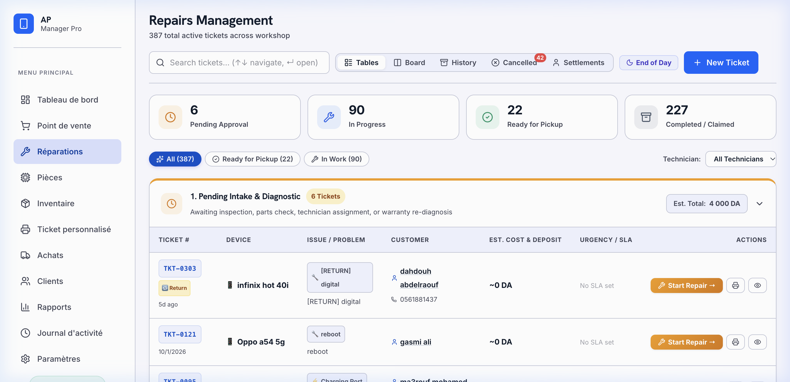
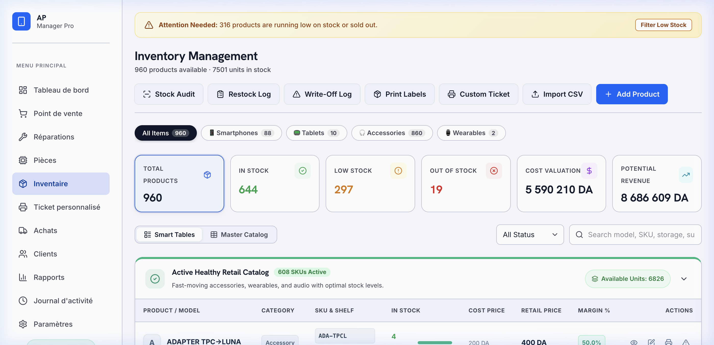
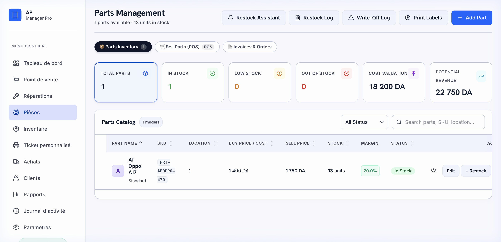
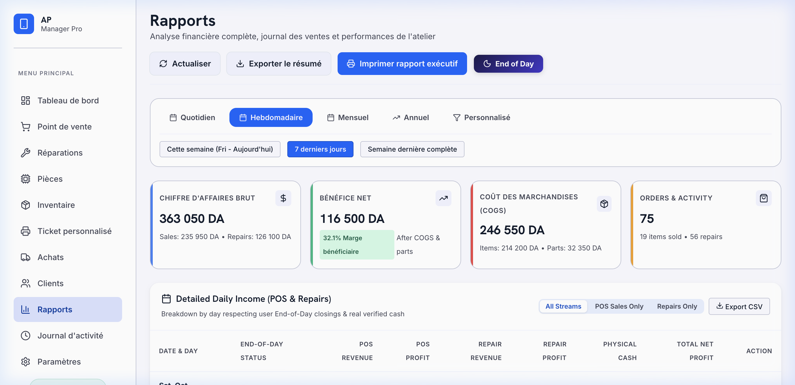
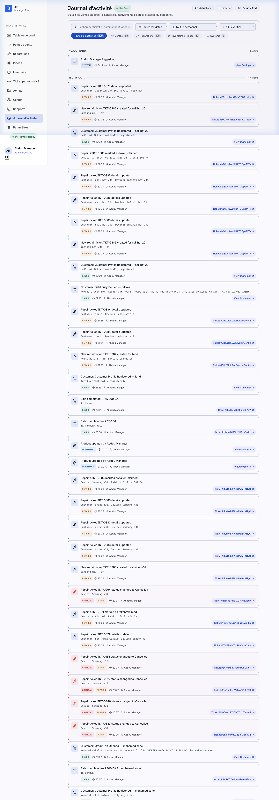

# 📱 PhoneShop Manager Pro — Complete Phone Repair Shop Management Suite

[](LICENSE)
[](https://react.dev/)
[](https://www.typescriptlang.org/)
[](https://vitejs.dev/)
[](https://firebase.google.com/)
[](https://expo.dev/)
[](https://nodejs.org/)
[](#-thermal-printing--hardware-integration)

A powerful, all-in-one, production-grade management system designed specifically for **independent phone repair shops, smartphone retailers, and electronics service centers**. 

**PhoneShop Manager Pro** combines a high-speed Point of Sale (POS), a real-time Kanban repair management board, full inventory and spare parts tracking, supplier purchase orders, customer CRM with WhatsApp integration, financial analytics, multi-user role permissions, and direct silent thermal printing — accompanied by a dedicated mobile app for workshop technicians.

---

## 📸 Visual Tour & Core Pages

### 📊 Executive Dashboard
Gain real-time business visibility in a single view: today's revenue, active repair pipeline, pending diagnostic tasks, low stock alerts, estimated profit margins, recent audit logs, and instant quick-action shortcuts.


---

### 🔧 Repair Management & Interactive Kanban Board
Track the entire lifecycle of client devices from intake to delivery. Drag and drop repair tickets across statuses, assign technicians, log unlock patterns/PINs, document diagnostics, allocate spare parts, and issue print tickets.



---

### 🛒 High-Speed Point of Sale (POS)
Engineered for counter-speed retail: instant barcode scanning, quick-access category filters, cart management with line-item discounts, multiple payment methods (Cash, Card, Transfer, Split payments), customer association, and 1-click silent thermal receipt printing.


---

### 📦 Comprehensive Retail Inventory Management
Track devices, accessories, and packaged goods. Monitor stock levels, SKU / barcodes, cost vs. selling prices, profit margins, brand and model categories, reorder thresholds, and perform instant stock adjustments.



---

### 🔩 Spare Parts & Components Catalog
Dedicated spare parts inventory tailored for phone repair: screens, batteries, charging ports, cameras, back glass, and flex cables. Track compatibility by phone model, allocate parts directly to repair orders, and monitor parts usage costs.



---

### 📋 Purchasing & Supplier Management
Streamline vendor relationships: track purchase orders, incoming stock shipments, supplier contact details, payment statuses (Paid, Partial, Unpaid), and automatically update warehouse stock on order reception.


---

### 👥 Customer Relationship Management (CRM)
Centralized customer directory with full history: contact details, total lifetime spend, repair history, store credit, loyalty points, and direct 1-click WhatsApp messaging for instant repair status notifications.


---

### 📈 Financial Analytics & Business Intelligence
Deep actionable insights into store performance: sales trends over time, repair turnaround metrics, profit & loss analysis, technician productivity benchmarks, expense breakdown, and CSV data exports.



---

### 📝 Complete Audit & Activity Log
Maintain full operational transparency with an immutable audit trail: track who logged in, created or modified repair orders, adjusted stock, made cash withdrawals, or modified system settings, complete with exact timestamps and user attribution.



---

### ⚙️ System Settings, Permissions & Hardware Config
Customize your store profile, tax rules, currency symbols, multi-lingual preferences, user roles, security access matrices, and configure thermal receipt / adhesive sticker printers.


---

### 🔐 Secure Multi-User Login
Enterprise-grade authentication with Firebase Auth. Protects your shop from unauthorized registrations with dedicated role enforcement for Super Admins, Store Owners, Managers, Cashiers, and Technicians.


---

## 🌟 Comprehensive Feature Breakdown

### 1. 📊 Executive Dashboard & Real-Time Metrics
- **Key Metric KPI Cards**: Today's Gross Revenue, Active In-Shop Repairs, Low Stock Warning Count, Net Profit calculation.
- **Visual Performance Graphs**: Daily/weekly sales volume and revenue charts.
- **Repair Status Overview**: Live counts of devices currently in Diagnostic, Waiting for Parts, In Progress, and Ready for Pickup.
- **Quick Action Triggers**: Instant modal launches for *New Sale*, *New Repair Ticket*, *Add Inventory Item*, *Add Customer*, and *End of Day Closing*.
- **Live Activity Stream**: Real-time ticker showing recent sales, status transitions, and inventory updates.

### 2. 🔧 Repair Lifecycle & Kanban Operations
- **Interactive Kanban Pipeline**: Drag and drop cards smoothly through stages:
  - `New / Intake` → `In Diagnosis` → `Waiting for Parts` → `In Progress` → `Ready for Pickup` → `Completed` → `Cancelled / Unrepairable`.
- **Intake Diagnostics & Intake Form**:
  - Record device Brand, Model, Serial / IMEI number, and physical condition checklist (scratches, cracks, water damage).
  - Visual Pattern Lock Grid & PIN record for technician testing.
  - Problem description, accessories left behind (SIM card, case, charger).
  - Upfront deposit, estimated repair cost, and estimated completion date.
- **Technician Assignment**: Allocate specific repair tickets to designated technicians.
- **Spare Parts Allocation**: Deduct parts directly from parts inventory and link their cost to the ticket.
- **Customer Self-Service Tracking**: Generate unique tracking codes and QR codes so customers can check repair status online without calling the shop.
- **Printable Repair Stickers & Receipts**: Print 80mm intake claim checks for customers and 50x30mm adhesive barcode labels for the physical phone backplate.

### 3. 🛒 Point of Sale (POS) Counter
- **Barcode & Scanner Support**: Fast product lookup via handheld USB/Bluetooth barcode scanners or manual search.
- **Visual Product Grid**: Filter products by category (Smartphones, Cases, Chargers, Audio, Protection) with stock indicators.
- **Flexible Cart Management**:
  - Adjust quantities, apply item-level or total cart percentage/fixed discounts.
  - Customer selection with instant customer creation shortcut.
  - Custom line items for non-catalog services or labor.
- **Multi-Payment Processing**:
  - Cash (with automatic change due calculation).
  - Credit / Debit Card.
  - Bank Transfer / Mobile Money.
  - Split Payments across multiple tender types.
- **1-Click Silent Thermal Printing**: Immediate 80mm receipt generation with store logo, tax breakdown, footer notes, and barcode.

### 4. 📦 Inventory & Stock Control
- **Product Cataloging**: SKU, Barcode, Brand, Model compatibility, Category, and item description.
- **Price Architecture**: Track Unit Cost vs. Retail Selling Price with automatic margin percentage calculation.
- **Stock Level Management**: Current stock on hand, min stock threshold, and reorder warning badges.
- **Stock Adjustments**: Log manual inventory adjustments (Damage, Theft, Loss, Stock Count reconciliation) with required reason notes.
- **Filter & Search**: Instant real-time filtering across thousands of inventory items.

### 5. 🔩 Phone Spare Parts Management
- **Specialized Component Catalog**: Screens (OLED, LCD, Original, Aftermarket), Batteries, Charging Ports, Cameras, Back Glass, Speakers, Motherboard flex cables.
- **Model Compatibility Mapping**: Tag parts with supported device models (e.g., iPhone 13 / 13 Pro, Samsung S23).
- **Cost & Stock Tracking**: Separate parts stock from retail items to ensure clean financial reporting.
- **Direct Repair Integration**: Easily attach parts to repair tickets during repair workflows.

### 6. 📋 Purchasing & Supplier Orders
- **Supplier Directory**: Maintain records of parts vendors, phone distributors, contact persons, phone numbers, and addresses.
- **Purchase Order Tracking**: Record incoming stock shipments, ordered quantities, unit costs, and arrival dates.
- **Financial Balance Tracking**: Manage payment status per PO (Fully Paid, Partially Paid, Unpaid balance).
- **Automated Stock Ingestion**: Receive shipments with one click to automatically increment retail and parts stock counts.

### 7. 👥 Customer Relationship Management (CRM)
- **Comprehensive Profiles**: Customer name, primary phone number, secondary phone, email, physical address, and internal notes.
- **Interaction History**: Complete log of all past repair orders and retail purchases made by the customer.
- **Financial Balances**: Store credit balances and customer receivables tracking.
- **1-Click WhatsApp Communication**: Open pre-formatted WhatsApp chat messages to notify customers when their device is ready for pickup or needs estimate approval.

### 8. 🌅 End of Day (Z-Report) Cash Reconciliation
- **Register Closing Wizard**: Structured closing workflow at the end of each shift or business day.
- **Cash Drawer Count**: Enter actual physical cash counted in drawer against expected system cash.
- **Discrepancy Reporting**: Automatic calculation of cash overage or shortage with mandatory explanation notes.
- **Summary Breakdown**: Total sales, cash sales, card sales, repair deposits collected, payouts, and net totals.
- **Thermal Daily Summary Print**: Direct printing of the daily financial summary for management archiving.

### 9. 📈 Advanced Reports & Business Analytics
- **Sales Analytics**: Revenue, profit margins, and sales volume segmented by day, week, month, or custom date range.
- **Repair Turnaround Metrics**: Average time from device intake to completion; analysis of top device failure causes.
- **Product & Category Performance**: Identify best-selling accessories and highest-margin repair services.
- **Technician Productivity**: Repairs completed per technician, revenue generated, and active workload balance.
- **Data Export**: Export tables and reports to CSV for external accounting or tax preparation.

### 10. 📝 Comprehensive Audit Trail (Activity Log)
- **Granular Activity Tracking**: Automatic logging of all critical actions:
  - User logins and session starts.
  - New repairs created, status transitions, technician reassignments.
  - POS sales completed, refunds, and voided tickets.
  - Inventory quantity changes and cost adjustments.
  - System configuration and user permission updates.
- **Searchable & Filterable**: Filter activity logs by user, date range, or action category.

### 11. ⚙️ Settings, Customization & Multi-User Access
- **Store Identity**: Customize shop name, legal registration number, phone numbers, address, tax rate, and receipt header/footer messages.
- **Multi-Currency & Tax Engine**: Set default currency symbol, position (prefix/suffix), and inclusive/exclusive tax rates.
- **Role-Based Access Control (RBAC)**:
  - **Super Admin**: Unrestricted system control, user provisioning, database configuration.
  - **Store Owner**: Full financial access, reports, inventory pricing, user management.
  - **Manager**: Day-to-day oversight, inventory management, repair approvals, POS.
  - **Cashier / Seller**: POS sales, customer creation, basic repair intake.
  - **Technician**: Access restricted to assigned repair workbench and status updates.
- **Multi-Language & RTL Layout**: Seamless toggle between English, French, and full Right-to-Left (RTL) Arabic.

### 12. 📲 Technician Mobile Companion App (`technician-app`)
- **Workshop Mobility**: Designed specifically for repair technicians stationed at the workbench or working on the shop floor.
- **Assigned Workbench Pipeline**: Technicians see their personal active queue, filterable by status (`In Diagnosis`, `Waiting for Parts`, `In Progress`, `Ready for Pickup`).
- **Visual Pattern Lock Grid & PIN**: View the client's screen unlock pattern visually on the mobile screen to easily test device touch, cameras, and components.
- **Hardware Camera Barcode Scanner**: Scan the adhesive repair sticker on the phone's backplate to open the exact ticket in under a second without typing.
- **New Ticket Intake on the Go**: Rapid intake form allowing technicians or floor staff to register new repair orders directly from their smartphone.
- **Personal Earnings & Productivity Reports**: Track daily/weekly completed repairs, turnaround speed, and calculated repair commissions.
- **Instant Cloud Sync**: Any status transition or note added on mobile immediately updates the manager's desktop Kanban board and the customer's live tracking link.
- **Multi-Language & Dark Mode**: Full support for English, French, and Arabic RTL layout with an eye-friendly dark theme.
- **Cross-Platform**: Built with **React Native & Expo SDK 57** for deployment on Android smartphones, tablets, iPhones, and iPads.

---

## 🖨️ Thermal Printing & Hardware Integration

PhoneShop Manager Pro features a dedicated, local printing microservice located in `phone-shop-manager/print-server/`. Built with **Node.js & Express.js**, it operates locally on port `3355` and bridges the web dashboard directly to hardware thermal printers for **silent, 1-click instantaneous printing** without browser print popups.

```
┌────────────────────────┐         HTTP POST (JSON)         ┌────────────────────────┐
│  React Web Application │ ────────────────────────────────> │ Local Node.js Server   │
│  (localhost:5173)      │ <──────────────────────────────── │ (localhost:3355)       │
└────────────────────────┘          Print Job Status         └───────────┬────────────┘
                                                                         │ ESC/POS / TSPL
                                                                         ▼
                                                             ┌────────────────────────┐
                                                             │ Hardware Thermal       │
                                                             │ Receipt & Label Printer│
                                                             └────────────────────────┘
```

### 🏷️ Hardware Compatibility & Tested Devices
The printing engine has been **thoroughly field-tested and optimized for Xprinter hardware**:
- **Xprinter XP-T80Q / POS-80**: 80mm High-Speed Thermal Receipt Printer (ESC/POS protocol, auto-cutter support, bold headers, formatted tabular receipt columns).
- **Xprinter XP-420B**: High-resolution Thermal Barcode & Label Printer (TSPL protocol, perfect for 50x30mm or 40x30mm adhesive repair stickers and barcode tags).
- **Generic ESC/POS Printers**: Compatible with standard USB, Ethernet, or serial ESC/POS thermal printers connected to macOS, Linux, or Windows spoolers.

### 📋 Print Server Environment Configuration (`print-server/.env`)

| Variable | Description | Default |
|---|---|---|
| `PRINTER_NAME` | System printer name for 80mm cash receipts (`lpstat -p -d`) | `XP_T80Q` |
| `LABEL_PRINTER_NAME` | System printer name for sticky repair labels | `XP_420B` |
| `PORT` | Local service port for print API | `3355` |
| `HAS_CUTTER` | Automatically triggers paper cutter after receipt | `true` |
| `LABEL_OFFSET_X` | Horizontal label margin calibration in printer dots | `12` |

---

## 🏗️ Repository Architecture

```
Phones-workspace/
├── docs/
│   └── screenshots/           # Application screenshots for documentation
│       ├── login.png
│       ├── dashboard.png
│       ├── repairs.png
│       ├── pos.png
│       ├── inventory.png
│       ├── parts.png
│       ├── purchasing.png
│       ├── customers.png
│       ├── reports.png
│       ├── activity.png
│       └── settings.png
│
├── phone-shop-manager/        # Main Desktop Web Application
│   ├── src/
│   │   ├── features/          # Feature domains (pos, repairs, inventory, etc.)
│   │   ├── components/        # Reusable UI component library
│   │   ├── store/             # Zustand state stores
│   │   ├── services/          # Firebase Firestore & Auth integration
│   │   ├── locales/           # i18n translation catalogs (en, fr, ar)
│   │   ├── hooks/             # Custom React lifecycle hooks
│   │   ├── lib/               # Firebase initialization and constants
│   │   ├── types/             # TypeScript interfaces and permission types
│   │   └── utils/             # Formatters, calculations, barcode helpers
│   ├── print-server/          # Dedicated Node.js ESC/POS & TSPL print server
│   │   ├── server.js          # Express endpoints for receipt & label dispatch
│   │   ├── package.json
│   │   └── .env.example
│   ├── electron/              # Optional desktop wrapper configuration
│   ├── index.html
│   ├── package.json
│   ├── vite.config.ts
│   └── .env.example
│
├── technician-app/            # Mobile Companion App for Workshop Staff
│   ├── src/
│   │   ├── screens/           # Mobile screens (repairs, details, profile)
│   │   ├── components/        # Mobile UI elements
│   │   ├── store/             # Mobile state management
│   │   └── lib/               # Firebase client for React Native
│   ├── app.json               # Expo configuration
│   ├── package.json
│   └── .env.example
│
├── firestore.rules            # Production-grade Firestore security rules
├── LICENSE                    # Open source MIT license
└── README.md                  # System manual and documentation
```

---

## 🚀 Step-by-Step Installation & Setup

### Prerequisites
- **Node.js** (v18.x or v20.x recommended) and **npm**
- A free **Google Firebase** account ([console.firebase.google.com](https://console.firebase.google.com))
- Modern Web Browser (Chrome, Edge, Brave, or Safari)
- *(Optional)* Thermal receipt or label printer for hardware printing

---

### Step 1: Clone the Repository

```bash
git clone https://github.com/YOUR_USERNAME/phoneshop-manager.git
cd phoneshop-manager
```

---

### Step 2: Set Up Your Own Firebase Backend

1. Navigate to the [Firebase Console](https://console.firebase.google.com/) and click **Add project**.
2. Give your project a name (e.g., `my-phone-shop`).
3. Enable **Authentication**:
   - Go to **Build → Authentication → Get Started**.
   - Under the **Sign-in method** tab, enable **Email/Password**.
4. Enable **Cloud Firestore Database**:
   - Go to **Build → Firestore Database → Create Database**.
   - Choose your preferred server region and start in **Test mode** (or deploy the included rules in step 2.3).
5. Register a Web App:
   - Click the Gear icon ⚙️ next to **Project Overview** → **Project settings**.
   - Under **Your apps**, click the Web icon `</>` to register your web application.
   - Note down the `firebaseConfig` keys provided.

#### 👤 Creating the Shop Administrator Account
Because this is a private internal enterprise application, **there is intentionally no public "Sign Up" button** on the login screen (this prevents random visitors from registering accounts into your store).
- In the **Firebase Console**, go to **Authentication → Users**.
- Click **Add User**.
- Enter your admin email address (e.g. `admin@example.com` or your own personal email) and set a secure password.

#### 🛡️ Configuring Security Rules & Super Admin Email
1. Open the file [`firestore.rules`](firestore.rules).
2. The initial fallback bootstrap email is set to:
   ```javascript
   function isSuperAdmin() {
     return request.auth != null && (
       request.auth.token.email == 'admin@example.com' || ...
     );
   }
   ```
   - **If you created your user with `admin@example.com`**, no code change is required.
   - **If you used a different email** (e.g. `owner@myshop.com`), simply replace `admin@example.com` in `firestore.rules` with your email.
3. Deploy the security rules to your Firebase project:
   ```bash
   npx firebase-tools login
   npx firebase-tools use --add
   npx firebase-tools deploy --only firestore:rules
   ```

---

### Step 3: Configure and Start the Manager Web Application

1. Navigate to the web application directory and install dependencies:
   ```bash
   cd phone-shop-manager
   npm install
   ```

2. Create your environment configuration file:
   ```bash
   cp .env.example .env
   ```

3. Open `.env` and fill in your Firebase project parameters:
   ```env
   VITE_FIREBASE_API_KEY=AIzaSyA1234567890abcdef
   VITE_FIREBASE_AUTH_DOMAIN=my-phone-shop.firebaseapp.com
   VITE_FIREBASE_PROJECT_ID=my-phone-shop
   VITE_FIREBASE_STORAGE_BUCKET=my-phone-shop.firebasestorage.app
   VITE_FIREBASE_MESSAGING_SENDER_ID=123456789012
   VITE_FIREBASE_APP_ID=1:123456789012:web:abcdef123456
   VITE_SUPER_ADMIN_EMAIL=admin@example.com
   ```
   *(Ensure `VITE_SUPER_ADMIN_EMAIL` matches the admin email you created in Firebase Auth)*.

4. Start the development server:
   ```bash
   npm run dev
   ```
   The application will be live at **http://localhost:5173**.

---

### Step 4: First Login & Adding Employees

1. Visit **http://localhost:5173** and log in with your admin credentials.
2. The system automatically initializes your user profile as **Super Admin** with full master permissions.
3. Once logged in, go to **Settings → Users**:
   - You can now invite and create accounts for all your staff members (**Cashiers**, **Technicians**, **Managers**) directly inside the application interface without touching the Firebase Console!

---

### Step 5: Start the Hardware Print Server (Optional)

If you have an 80mm thermal receipt printer or adhesive label printer connected to your computer:

1. Open a new terminal window:
   ```bash
   cd phone-shop-manager/print-server
   npm install
   ```

2. Create your print server configuration:
   ```bash
   cp .env.example .env
   ```

3. Identify your system printer names:
   - On macOS/Linux: Run `lpstat -p -d`
   - On Windows: Check printer names in *Control Panel → Devices and Printers*

4. Edit `print-server/.env`:
   ```env
   PRINTER_NAME=XP_T80Q
   LABEL_PRINTER_NAME=XP_420B
   PORT=3355
   HAS_CUTTER=true
   LABEL_OFFSET_X=12
   ```

5. Launch the print server:
   ```bash
   node server.js
   ```
   The print server will listen on port `3355`. When you click "Print Receipt" or "Print Label" anywhere in the web app, print jobs will dispatch instantly to your thermal printer.

---

### Step 6: Technician Mobile Companion App (`technician-app`)

The **Technician Companion App** is a purpose-built React Native mobile application allowing bench technicians and floor staff to view assigned devices, inspect visual pattern locks, scan device barcode stickers with the phone camera, update repair statuses, and track daily earnings.

#### 👤 How to Create Accounts to Log Into the Mobile App
For security, the mobile app connects directly to your Firestore database and strictly enforces role permissions. **Technicians cannot register themselves publicly**; their accounts must be provisioned by the shop owner:

1. Open the main **PhoneShop Manager Pro** desktop web dashboard (`http://localhost:5173`).
2. Log in with your **Admin / Super Admin** account.
3. Navigate to **Settings → Users** tab.
4. Click **Add User** (or "New Staff Member"):
   - Enter Full Name (e.g., `Karim Technician`).
   - Enter Staff Email (e.g., `karim.tech@myshop.com`).
   - Enter a Secure Password.
   - Select Role: **Technician** (which maps to `repair_agent` or `admin`).
5. Click **Save**.
6. The account is instantly authorized. The technician can now open the mobile app and log in with these exact credentials.

> [!NOTE]
> The mobile app automatically verifies user authorization on login. Only accounts with roles `repair_agent`, `sales_agent`, or `admin` are permitted access. Inactive or revoked staff accounts are blocked immediately.

---

#### 📥 How to Download & Install the Mobile App on Phones

You have two simple ways to get the app onto technicians' phones or tablets:

##### Method A: Instant Launch with Expo Go (Quickest — No Compilation Required)
1. On the technician's phone or tablet, download the free **Expo Go** application:
   - 🤖 **Android**: [Download on Google Play Store](https://play.google.com/store/apps/details?id=host.exp.exponent)
   - 🍏 **iOS (iPhone/iPad)**: [Download on Apple App Store](https://apps.apple.com/app/expo-go/id982107779)
2. In your terminal on your computer, navigate to the mobile app directory:
   ```bash
   cd technician-app
   npm install
   cp .env.example .env
   ```
3. Populate `technician-app/.env` with your Firebase credentials (using `EXPO_PUBLIC_` prefixes):
   ```env
   EXPO_PUBLIC_FIREBASE_API_KEY=AIzaSyA1234567890abcdef
   EXPO_PUBLIC_FIREBASE_AUTH_DOMAIN=my-phone-shop.firebaseapp.com
   EXPO_PUBLIC_FIREBASE_PROJECT_ID=my-phone-shop
   EXPO_PUBLIC_FIREBASE_STORAGE_BUCKET=my-phone-shop.firebasestorage.app
   EXPO_PUBLIC_FIREBASE_MESSAGING_SENDER_ID=123456789012
   EXPO_PUBLIC_FIREBASE_APP_ID=1:123456789012:web:abcdef123456
   ```
4. Start the Expo development server:
   ```bash
   npx expo start
   ```
5. **Open on Phone**:
   - **Android**: Open the Expo Go app and tap "Scan QR code", then scan the terminal QR code.
   - **iOS**: Open the native iOS Camera app, point it at the QR code, and tap the "Open in Expo Go" banner.
   - The app will load onto the device immediately!

##### Method B: Direct Pre-Built Android APK Download (Recommended)
You do **not** need to compile or build the app from source code! A ready-to-install Android APK is available directly:

- **From GitHub Releases**:
  [](https://github.com/YOUR_USERNAME/phoneshop-manager/releases/latest/download/Auto-Manager.apk)
  
  👉 **[Download Latest APK Release (Auto-Manager.apk)](https://github.com/YOUR_USERNAME/phoneshop-manager/releases/latest/download/Auto-Manager.apk)**

- **From the Running Web Dashboard**:
  When running the web manager app, you can download the APK directly at:
  ```
  http://localhost:5173/downloads/Auto-Manager.apk
  ```
  Or simply click the **"Download Technician App (.APK)"** button located directly inside **Settings → Staff & Users**.

> [!TIP]
> **For the Repository Owner (Publishing the APK on GitHub)**:
> Because GitHub limits individual git commits to 100MB, large installer packages like Android APKs (102MB) are distributed via **GitHub Releases** (which supports up to 2GB per file):
> 1. Push your repository to GitHub.
> 2. On your GitHub repository page, click **Releases** (on the right sidebar) → **Draft a new release**.
> 3. Enter a tag name (e.g. `v1.0.0`) and title `v1.0.0 — PhoneShop Manager Pro`.
> 4. Drag and drop the APK file (`Auto-Manager.apk` located in `phone-shop-manager/public/downloads/`) into the release binaries box.
> 5. Click **Publish release**. The permanent download link above will immediately start serving the file to all users!

---

#### 📱 How to Use the App (Daily Technician Workflow)

1. **Sign In**: Open the app and log in using the email and password created in **Settings → Users**.
2. **Assigned Workbench**: View all repair jobs assigned to you. Filter across tabs (`All`, `In Diagnosis`, `Waiting for Parts`, `In Progress`, `Ready for Pickup`).
3. **Camera Barcode / QR Scanner**: Tap the Barcode Scanner icon on the top right. Point your phone camera at the adhesive sticker on the back of any client phone to instantly load its repair ticket without typing.
4. **Hardware Diagnostic & Pattern Locks**: Open any repair ticket to review customer complaints, IMEI/serial number, accessories left behind, and inspect the **Visual Pattern Lock Grid or PIN** to unlock and test the device.
5. **Updating Status**: Tap one-touch status buttons (e.g. `Start Repair`, `Waiting for Parts`, `Mark Ready for Pickup`). Status changes immediately sync in real-time to the desktop Kanban board and the customer's live tracking web link.
6. **New Ticket Intake on the Go**: Take in a walk-in repair directly from the phone using the `+ New Ticket` button.
7. **Technician Reports & Productivity**: Open the Reports tab to see daily/weekly completed repairs, average turnaround times, and personal commission earnings.
8. **Settings & Dark Mode**: Switch between English, French, and Arabic (with mirrored RTL layout), or toggle dark theme for night benchwork.

---

## 🔒 Security & Privacy Architecture

- **100% Data Sovereignty**: All your data lives in **your own Firebase project**. No third-party servers, telemetry, or external analytics have access to your client records, financial metrics, or sales figures.
- **Strict Role-Based Firestore Rules**: Read, write, and delete permissions are enforced directly at the database layer via [`firestore.rules`](firestore.rules).
- **Environment Isolation**: API keys and master emails are stored in `.env` files that are strictly excluded by `.gitignore`.
- **Zero Risk to Other Users**: When anyone deploys this repository, they link it to their own separate Firebase credentials; no data is ever shared across installations.

---

## 🌍 Multi-Language & Localization

PhoneShop Manager Pro features built-in internationalization across the entire user interface:

| Language | Code | Layout Direction | Supported Features |
|---|---|---|---|
| **English** | `en` | Left-to-Right (LTR) | Complete UI, receipts, notifications, charts |
| **French** | `fr` | Left-to-Right (LTR) | Complete UI, receipts, notifications, charts |
| **Arabic** | `ar` | **Right-to-Left (RTL)** | Complete UI with mirrored RTL navigation, Arabic receipts & currencies |

Language can be switched instantly from the top navigation bar or under **Settings**.

---

## 💻 Tech Stack Summary

| Layer | Technologies |
|---|---|
| **Web Frontend** | React 19, TypeScript 5, Vite 6, TailwindCSS / CSS Modules, Lucide Icons |
| **State Management** | Zustand |
| **Backend & Database** | Google Cloud Firestore, Firebase Authentication |
| **Print Server** | Node.js, Express.js, `node-thermal-printer` |
| **Mobile Companion** | React Native, Expo SDK 57, Expo Router |
| **Desktop Wrapper** | Electron (ready for standalone offline desktop bundling) |
| **i18n & RTL** | i18next, react-i18next |

---

## 🤝 Contributing

We welcome contributions from the community! Whether you want to add support for new thermal printers, improve translations, or introduce new features:

1. Fork the repository
2. Create your feature branch (`git checkout -b feature/awesome-feature`)
3. Commit your changes (`git commit -m 'Add awesome feature'`)
4. Push to your branch (`git push origin feature/awesome-feature`)
5. Open a Pull Request

---

## 📄 License

This project is licensed under the **MIT License** — see the [LICENSE](LICENSE) file for complete details. You are free to use, modify, distribute, and deploy this software for commercial or personal use.

---

## 💬 Community & Support

Built with ❤️ for phone repair shop owners, independent technicians, and small electronics retail businesses worldwide. If you find this software helpful, consider giving it a ⭐ on GitHub!
